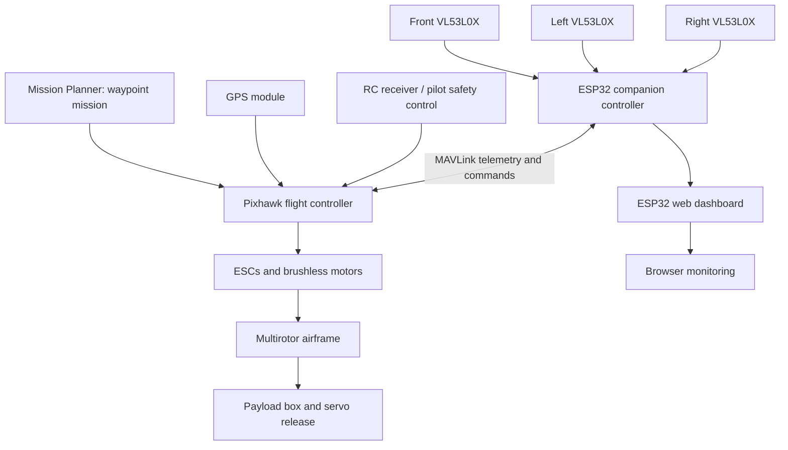

# Aero Drop — Smart Drone System for Medical and Essentials Delivery

> An academic UAV project combining GPS waypoint-based delivery with a prototype real-time, reactive obstacle-avoidance concept using an ESP32 companion computer, three VL53L0X Time-of-Flight sensors, and a Pixhawk flight controller.

**Institution:** Sir C. R. Reddy College of Engineering (Autonomous)  
**Department:** Electronics and Communication Engineering  
**Guide (presentation):** Mr A. M. Vamsi Krishna, M.Tech (Ph.D), Assistant Professor, ECE  
**Academic project team (as listed in presentation):**
- 23B85A0420 — U.S.V. Ajay
- 23B85A0419 — T. Pavani
- 22B81A04G5 — Shaik Sadhiq
- 22B81A04G0 — S. Venkata Srikanth
- 22B81A04H0 — T. Sai Ganesh

---

## 1. Project overview

Aero Drop explores the use of an autonomous multirotor drone to carry lightweight medical supplies and essentials to locations where road access, traffic, or distance may delay delivery. The delivery concept uses GPS waypoints planned in Mission Planner, a flight controller for stabilization and navigation, and a servo-operated mechanism to release a payload.

The associated obstacle-avoidance work adds a reactive short-range layer: an ESP32 reads three VL53L0X ToF sensors mounted toward the front, left, and right; evaluates a frontal obstacle; issues control messages to Pixhawk over MAVLink; and exposes flight and sensor status through an ESP32-hosted web page.

**Important scope note:** this is a student prototype, not a certified medical-delivery or production UAV system. The avoidance design described in the project report is reactive and short-range; it does not implement SLAM, a 3D map, or global path planning.

## 2. Main objectives

- Demonstrate GPS waypoint navigation for a lightweight delivery use case.
- Carry a small payload in a dedicated box or compartment.
- Trigger a servo-based payload-release mechanism.
- Detect nearby obstacles with front/left/right ToF measurements.
- Use MAVLink communication between the ESP32 companion controller and Pixhawk.
- Attempt a reactive avoidance maneuver and return control to the planned mission.
- Monitor flight mode, arming state, sensor distances, and obstacle state through a web interface.

## 3. System architecture



The diagram expresses the documented high-level design. Confirm the exact wiring, serial port, baud rate, Pixhawk firmware, and command implementation against the final source code and flight-controller configuration before using it as a build schematic.

## 4. Hardware inventory

| Component | Role | Project notes |
|---|---|---|
| Pixhawk 2.4.8 flight controller | Stabilization, flight modes, waypoint mission execution | Listed in project details; verify exact board/firmware before deployment |
| NEO-8M GPS module | Position and waypoint navigation | Used for GPS-based mission planning |
| ESP32 development board | Sensor processing, avoidance logic, web monitoring | Companion controller in the obstacle-avoidance report |
| 3 × VL53L0X ToF sensors | Short-range front, left, and right distance sensing | Sensor range depends on target, lighting, mounting, and conditions; project report gives approximately 2 m |
| EMAX 930 KV brushless motors | Multirotor propulsion | Listed in project component details |
| ReadyToSky 30 A ESCs | Motor speed control | Listed in project component details |
| Propellers and drone frame | Lift and airframe | Match propellers and motor ratings to the actual build |
| 5200 mAh LiPo battery | Main power source | Verify cell count, voltage, current rating, and safe operating limits on the actual pack |
| Pixhawk power module / power distribution | Power monitoring and distribution | Confirm wiring and current ratings before powering the aircraft |
| Servo motor and payload box | Payload retention/release | Mission presentation includes a `DO_SET_SERVO` example; verify the configured output and PWM values |
| RC transmitter and receiver | Manual pilot control / safety intervention | Presentation lists FlySky FS-i6 and receiver |

**Do not treat this table as a wiring guide.** Confirm pinouts, voltage levels, common ground, current capacity, connector polarity, and failsafe behavior using the actual hardware documentation.

## 5. Software and protocols

- **Mission Planner:** create and upload GPS waypoint missions and review telemetry.
- **MAVLink:** exchange flight-state telemetry and control messages between the ESP32 and Pixhawk.
- **FreeRTOS:** organise concurrent embedded tasks on the ESP32.
- **ESP32 web server:** show flight mode, armed state, sensor distances, and obstacle status; the report states that the page refreshes every 500 ms.
- **Servo command:** the presentation shows a `DO_SET_SERVO` mission command; actual output channel and PWM values must be taken from the configured build.

### Documented FreeRTOS task roles

1. **MAVLink task** — communication with Pixhawk; reads flight state and sends supported commands.
2. **Sensor task** — reads the ToF sensors.
3. **Avoidance task** — evaluates the obstacle threshold and selects a reactive maneuver.
4. **Web-server task** — serves monitoring information to a browser.
5. **Serial/debug task** — diagnostic output.

These are the roles stated in the process document. Scheduling priorities, stack sizes, queue/semaphore use, and task periods are not specified here and should not be guessed.

## 6. Reactive obstacle-avoidance flow

1. Continuously sample the front, left, and right ToF sensors.
2. Compare the front measurement with the configured obstacle threshold.
3. If an obstacle is detected, issue a temporary backward maneuver using the documented RC-override approach.
4. Compare left and right measurements.
5. Issue a velocity command toward the side considered safer by the current logic.
6. Release/clear the temporary control override as implemented.
7. Allow the flight controller's autonomous mission to continue.

This is a **reactive local avoidance strategy**. It does not guarantee that the chosen side is obstacle-free beyond sensor coverage, and the report does not establish behavior for every sensor fault, communication loss, or moving obstacle. Those cases require dedicated tests and failsafe logic.

## 7. Build and operation workflow

This repository currently packages the project documentation and supplied evidence. The ESP32 firmware source, exact dependency versions, pin mapping, UART settings, and parameter files were not present in the materials used to assemble this package, so a reproducible firmware build cannot yet be documented honestly.

Suggested workflow once the final source and configuration are added:

1. Inspect the exact ESP32 board and Pixhawk firmware version.
2. Confirm sensor I²C addresses, wiring, voltage levels, and sensor initialization.
3. Confirm ESP32–Pixhawk serial wiring, baud rate, MAVLink dialect, and heartbeat handling.
4. Build and test sensor readings on the bench before enabling any flight commands.
5. Verify all control commands in a safe simulation or restrained bench setup where appropriate.
6. Validate RC override release, command timeouts, loss-of-link behavior, and pilot takeover.
7. Test in a controlled, legally permitted area with a trained pilot, clear perimeter, and no bystanders.
8. Record mission logs, environmental conditions, payload mass, distance measurements, and every test outcome.

**Never test unverified obstacle-avoidance commands over people or near roads, power lines, buildings, or other aircraft.** Keep a capable pilot able to take control, and comply with applicable local UAV rules.

## 8. Testing and reported observations

The process document describes tests involving autonomous mission flights, Loiter-mode hovering, and obstacle detection. It reports that the system detected obstacles, executed avoidance maneuvers, and resumed the mission. The presentation includes Mission Planner waypoint/telemetry material.

Project discussions also reported payload delivery approximately **2–3 m from the target** during tests at college and Kondruprolu village. This is recorded as a reported observation, not a statistically validated accuracy figure: the available notes do not provide the number of trials, target-distance measurement method, payload mass, wind conditions, or dispersion statistics.

### Suggested test log

| Test ID | Mode / scenario | Obstacle position | Sensor readings | Avoidance result | Mission resumed? | Payload offset | Notes |
|---|---|---|---|---|---|---|---|
| T-01 | Loiter hover | None | Record actual values | Not applicable | Not applicable | Not applicable | Add date and conditions |
| T-02 | Autonomous waypoint mission | None | Record actual values | Not applicable | Yes/No | Measure actual value | Attach flight log |
| T-03 | Front obstacle | Front | Record front/left/right | Record actual outcome | Yes/No | Measure actual value | Repeat safely |
| T-04 | Front obstacle with unequal side clearance | Front; unequal left/right | Record all values | Record selected side | Yes/No | Measure actual value | Verify threshold behavior |
| T-05 | Sensor/telemetry fault test | Controlled test only | Record fault | Record failsafe response | Yes/No | Not applicable | Do not conduct in risky flight conditions |

Do not fill the table with invented measurements. Add real logs and photographs as they become available.

## 9. Limitations

- VL53L0X sensors provide short-range sensing and can be affected by target reflectivity, sunlight, alignment, and environmental conditions.
- Three directional sensors provide limited coverage; they cannot see all directions or build a complete map.
- The described algorithm is reactive, not SLAM or full path planning.
- A temporary override and velocity-command transition must be tested against the exact Pixhawk firmware and flight mode.
- Delivery accuracy and repeatability require measured multi-trial results.
- Medical payload transport requires additional validation for payload security, temperature, hygiene, chain of custody, and regulatory compliance.
- No claim of production readiness, medical certification, or fully autonomous safety is made.

## 10. Future enhancements

- Add systematic failsafe handling for sensor failure, stale readings, MAVLink loss, and invalid flight states.
- Improve obstacle coverage and evaluate longer-range sensing, including LiDAR where appropriate.
- Record telemetry and sensor data for repeatable testing.
- Add dynamic path planning or mapping only after the baseline system is validated.
- Quantify payload delivery error using repeated trials and publish mean, median, spread, and test conditions.
- Document battery endurance versus payload mass and mission distance.

## 11. Repository layout

```text
AeroDrop-GitHub/
├── README.md
├── LICENSE
├── .gitignore
├── docs/
│   ├── SYSTEM_ARCHITECTURE.md
│   ├── OBSTACLE_AVOIDANCE.md
│   ├── TESTING_AND_VALIDATION.md
│   └── CONTRIBUTING.md
└── assets/
    ├── photos/             # Supplied prototype and component photos
    ├── presentations/      # Supplied PowerPoint files
    ├── videos/             # Supplied flight videos
    └── drone process list… # Supplied process/documentation file
```

The files supplied for this package did **not** include a confirmed, complete ESP32 firmware source tree. Add the actual code, dependency list, pin map, parameter exports, and test logs before presenting this repository as a fully reproducible firmware release.

## 12. Acknowledgement

Developed as an academic project in the Department of Electronics and Communication Engineering, Sir C. R. Reddy College of Engineering (Autonomous). Team and guide details above are reproduced from the supplied presentation.
