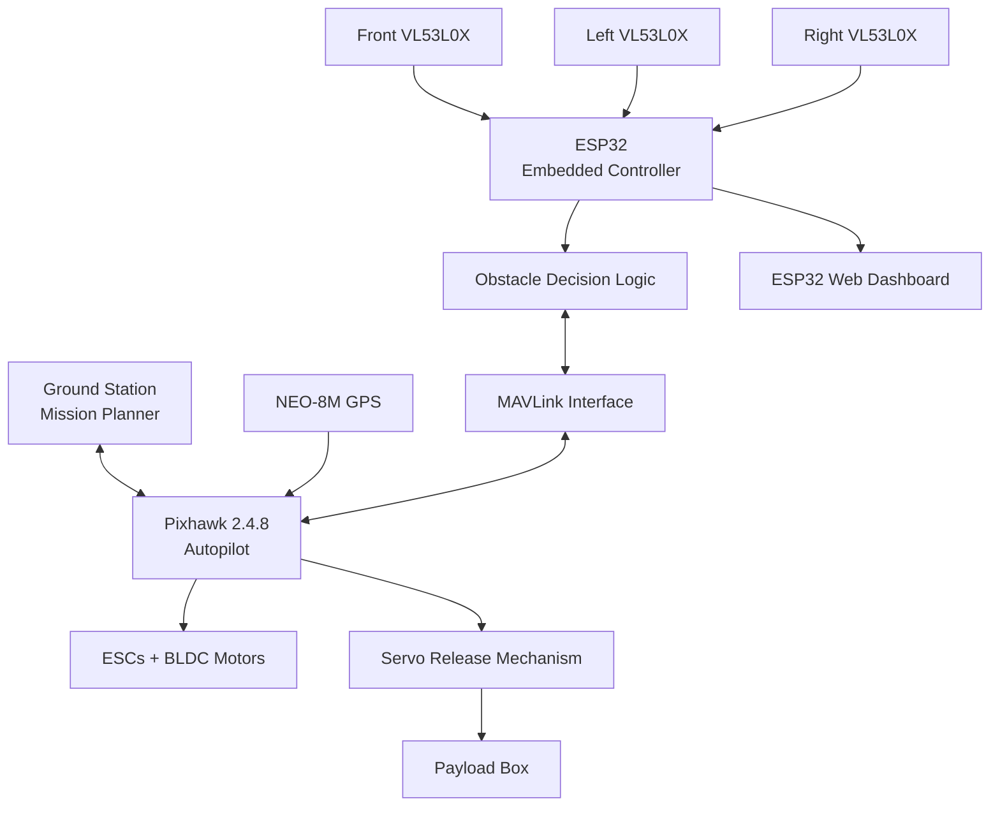
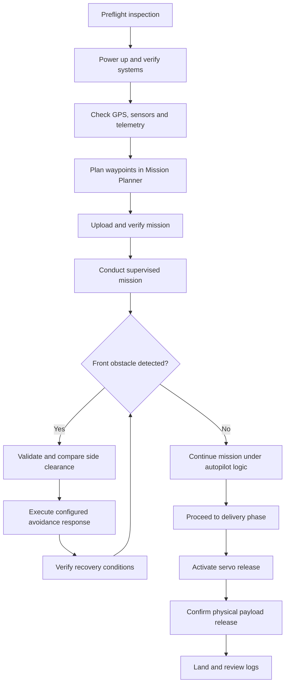

<div align="center">

# 🚁 A E R O  D R O P
### SMART DRONE SYSTEM FOR MEDICAL & ESSENTIALS DELIVERY

**Autonomous waypoint navigation · Embedded obstacle response · Servo payload release**

<p>
  
  
  
  
  
</p>

> **A connected drone-delivery prototype that brings together flight control, GPS waypoint missions, local distance sensing, embedded decision logic, telemetry, and a servo-operated payload mechanism.**

[Project Overview](#-project-overview) · [Architecture](#-system-architecture) · [Obstacle Avoidance](#-real-time-obstacle-avoidance) · [Payload Delivery](#-payload-delivery) · [Testing](#-testing-and-validation)

</div>

---

<h2 align="center">🛰️ Aero Drop — System Architecture</h2>

<p align="center">
  
</p>


## 🌌 Project at a Glance

<table>
<tr>
<td width="50%">

### 🛰️ Autonomous Mission

Waypoint-based route planning and mission monitoring using Mission Planner and a Pixhawk flight controller.

</td>
<td width="50%">

### 🛡️ Local Obstacle Response

Three VL53L0X Time-of-Flight sensors measure front, left, and right clearance for the programmed response logic.

</td>
</tr>
<tr>
<td width="50%">

### 📦 Payload Release

A servo-operated mechanism is designed to release a carried item at the configured delivery stage.

</td>
<td width="50%">

### 🌐 Embedded Monitoring

An ESP32-hosted web dashboard displays selected flight status and sensor information.

</td>
</tr>
</table>

> **Evidence note:** This repository describes the project based on the available project material. Exact firmware behavior, measured performance, payload capacity, wiring, and build configuration must be verified against the actual implementation. Unknown values are marked as unverified instead of being guessed.

---


<h2 align="center">🚁 Aero Drop — Prototype Gallery</h2>

<p align="center">
  <strong>Real Prototype | Hardware Integration | Payload Delivery</strong>
  <br>
  <em>Photographs from the Aero Drop Smart Drone System project.</em>
</p>

<table>
  <tr>
    <td align="center" width="50%">
      
      <br>
      <strong>🚁 Prototype Overview</strong>
      <br>
      <sub>Drone frame and onboard electronics</sub>
    </td>
    <td align="center" width="50%">
      
      <br>
      <strong>🔧 Drone Assembly</strong>
      <br>
      <sub>Prototype structure and component arrangement</sub>
    </td>
  </tr>
  <tr>
    <td align="center" width="50%">
      
      <br>
      <strong>⚙️ Hardware Integration</strong>
      <br>
      <sub>Embedded electronics and wiring arrangement</sub>
    </td>
    <td align="center" width="50%">
      
      <br>
      <strong>📦 Payload Delivery Prototype</strong>
      <br>
      <sub>Drone frame and payload box arrangement</sub>
    </td>
  </tr>
</table>

<p align="center">
  <em>A visual record of the Aero Drop prototype development.</em>
</p>


## 📚 Contents

- [Project Overview](#-project-overview)
- [Problem Statement](#-problem-statement)
- [Objectives](#-project-objectives)
- [What Makes Aero Drop Special](#-what-makes-aero-drop-special)
- [System Architecture](#-system-architecture)
- [Hardware Components](#-hardware-components)
- [Software and Technologies](#-software-and-technologies)
- [Autonomous Navigation](#-autonomous-navigation-with-mission-planner)
- [Real-Time Obstacle Avoidance](#-real-time-obstacle-avoidance)
- [Payload Delivery](#-payload-delivery)
- [MAVLink Communication](#-mavlink-communication)
- [ESP32 Web Dashboard](#-esp32-web-dashboard)
- [FreeRTOS Task Design](#-freertos-task-design)
- [End-to-End Mission](#-end-to-end-mission-workflow)
- [Electrical and Mechanical Integration](#-electrical-and-mechanical-integration)
- [Testing and Validation](#-testing-and-validation)
- [Known Limitations](#-known-limitations)
- [Safety](#-safety-considerations)
- [Installation and Reproduction](#-installation-and-reproduction)
- [Repository Structure](#-repository-structure)
- [Future Work](#-future-work)
- [Project Team](#-project-team)
- [Glossary](#-glossary)
- [Engineering Checklists](#-engineering-checklists)

---

# 🌍 Project Overview

**Aero Drop** is an academic drone-delivery prototype created to explore the use of autonomous flight and embedded sensing for the transportation of medical supplies and essential items.

The concept combines a flight-control platform with a companion embedded subsystem. The flight controller manages the configured flight and navigation functions. The ESP32-based subsystem reads local distance sensors, evaluates the programmed obstacle-response conditions, exchanges supported messages with the autopilot, and hosts a browser-based monitoring page.

The payload-delivery concept uses a servo-operated mechanism. The mission is prepared using Mission Planner, where waypoints and supported mission actions can be configured and reviewed.

The project therefore brings several engineering areas into one demonstrator:

- Embedded C/C++-style firmware development, depending on the actual implementation.
- Flight-controller configuration and autonomous mission planning.
- GPS-assisted navigation.
- Time-of-Flight distance sensing.
- Decision logic for local obstacle response.
- MAVLink telemetry and command communication.
- Servo actuation and payload mechanics.
- Web-based embedded monitoring.
- Task separation using FreeRTOS, as described in the project material.
- Test planning, observation, and documentation.

## 🎯 The Engineering Challenge

A waypoint mission describes a planned route, but it does not by itself prove that the route is clear of obstacles. A delivery prototype also has to coordinate flight state, sensing, control commands, and payload actuation.

Aero Drop explores the relationship between these responsibilities. The ToF sensors provide local distance information; the ESP32 evaluates those readings; the communication layer connects the embedded logic to the flight controller; and the flight controller continues to manage the configured aircraft functions.

The goal is not to claim that three sensors solve every obstacle-navigation problem. The goal is to demonstrate and document a practical embedded architecture, understand its limitations, and establish a basis for more rigorous testing.

## 🧭 Intended Use

The prototype is intended for academic demonstration and controlled experimentation involving:

- Lightweight-item delivery concepts.
- Waypoint mission planning.
- Embedded sensor integration.
- Local obstacle-response logic.
- Flight telemetry monitoring.
- Servo-controlled payload mechanisms.
- Integration of microcontrollers and autopilot systems.

It is **not represented as a certified commercial delivery platform** or as a guarantee of safe operation in uncontrolled environments.

---

# 🧩 Problem Statement

Moving small essential items to locations that are difficult to access can create logistical challenges. A drone may provide a useful research platform for exploring faster or more flexible transport, but a delivery drone must coordinate multiple systems.

The project addresses the following design questions:

1. How can a predefined waypoint mission be created and monitored?
2. How can a flight controller and an additional embedded controller be integrated?
3. How can distance sensors provide local obstacle information?
4. How can the programmed logic compare the available left and right clearances?
5. How can the embedded subsystem communicate supported control commands to an autopilot?
6. How can a servo-operated mechanism release a carried item?
7. How can selected sensor and flight-state information be shown through a simple dashboard?
8. How should the prototype be tested without confusing a successful demonstration with a verified performance guarantee?

## 🎯 Project Objectives

- Build a drone prototype intended to demonstrate medical and essential-item delivery.
- Use a Pixhawk 2.4.8 flight controller as the autopilot platform.
- Use a NEO-8M GPS receiver as a positioning source.
- Prepare waypoint missions in Mission Planner.
- Integrate an ESP32-based embedded sensing and monitoring subsystem.
- Use three VL53L0X ToF sensors in front, left, and right directions.
- Evaluate front-obstacle detection against a configured threshold.
- Compare side-clearance readings as part of the avoidance decision.
- Use supported MAVLink communication for the implemented telemetry and control workflow.
- Integrate a servo-operated payload-release mechanism.
- Present selected flight and sensor values on an ESP32-hosted web page.
- Organize embedded activities into tasks as described by the FreeRTOS-based design.
- Document the evidence needed to measure repeatability, delivery deviation, payload capability, and flight endurance.

---

# ✨ What Makes Aero Drop Special?

## 1. A combined flight-and-embedded architecture

The project does not treat the flight controller and ESP32 as interchangeable. The autopilot handles its configured flight-control functions, while the ESP32 subsystem is intended to handle local distance sensing, decision logic, communication, and monitoring.

## 2. Three-direction local distance sensing

The front sensor provides a forward distance measurement. The left and right sensors provide comparative side-clearance information. This arrangement supports a simple local decision concept without claiming full environmental mapping.

## 3. Mission planning plus a payload mechanism

The project connects a waypoint-based mission workflow with a physical release mechanism. The mission and the mechanism must be configured and tested together; a command alone does not prove that a payload has physically been released.

## 4. Visible embedded-system behavior

The ESP32-hosted dashboard is intended to make selected flight-state and sensor information easier to observe during development and controlled tests.

## 5. An opportunity for measurable engineering

The project creates concrete areas for validation: sensor range, threshold behavior, command handling, recovery behavior, payload mass, release reliability, flight endurance, and delivery deviation.

<table>
<tr><th>Feature</th><th>What it contributes</th><th>Evidence to retain</th></tr>
<tr><td>Waypoint navigation</td><td>Predefined mission route</td><td>Mission file and flight log</td></tr>
<tr><td>ToF sensing</td><td>Local distance information</td><td>Sensor logs and reference measurements</td></tr>
<tr><td>Obstacle response</td><td>Programmed reaction to front obstacle conditions</td><td>Sensor readings, commands, and flight log</td></tr>
<tr><td>Servo release</td><td>Physical payload release</td><td>Video, configuration, and release-test records</td></tr>
<tr><td>Web dashboard</td><td>Readable system status</td><td>Screenshots and source code</td></tr>
<tr><td>FreeRTOS task design</td><td>Separation of embedded activities</td><td>Task definitions and timing notes</td></tr>
</table>

---

# 🏗️ System Architecture



## Architecture Layers

### Ground-station layer

Mission Planner is used to create, review, upload, and monitor supported missions. The ground station can display telemetry provided by the configured autopilot and telemetry link.

### Navigation layer

The NEO-8M supplies GPS position information to the flight controller. The quality of this information depends on satellite reception, antenna placement, and the operating environment.

### Flight-control layer

The Pixhawk 2.4.8 runs the configured autopilot firmware and manages supported flight-control functions. Its exact behavior depends on firmware, parameters, vehicle configuration, and active flight mode.

### Sensor layer

Three VL53L0X sensors provide directional distance measurements. They are not a full 3D perception system and do not guarantee that every obstacle is detected.

### Embedded decision layer

The ESP32 reads sensor values and evaluates the programmed conditions. The actual implementation should define how it handles invalid readings, stale measurements, and ambiguous clearance.

### Communication layer

MAVLink is the intended protocol for exchanging supported telemetry and control messages. The precise messages, units, coordinate frames, timeouts, and interface configuration must be verified from the firmware.

### Actuation layer

The propulsion system is driven through the flight controller and ESCs. The servo-operated mechanism is intended to release the payload at the configured stage.

### Monitoring layer

The ESP32 web server provides selected information in a browser. It is a development and monitoring aid, not a replacement for a safety system or pilot-control interface.

---

# 🔩 Hardware Components

## Hardware Summary

| Component | Documented specification | Main role |
|---|---|---|
| Flight controller | Pixhawk 2.4.8 | Autopilot and flight-control functions |
| GPS | NEO-8M | Positioning information |
| Embedded controller | ESP32 | Sensor processing, avoidance logic, monitoring |
| Distance sensors | 3 × VL53L0X | Front/left/right ranging |
| BLDC motors | EMAX 930KV | Propulsion |
| ESCs | ReadyToSky 30A | Motor-speed control |
| Battery | 5200 mAh LiPo | Main energy source |
| Power interface | Pixhawk power module | Flight-controller power interface and supported monitoring |
| Actuator | Servo motor | Payload release |
| Payload enclosure | Prototype payload box | Carries the delivery item |
| Structure | Frame and propellers | Mechanical support and thrust generation |

## Pixhawk 2.4.8 Flight Controller

**Purpose:** Main flight-control platform.

The Pixhawk is the central autopilot component. It executes the configured flight firmware and coordinates the supported navigation and motor-control functions.

Responsibilities in the system include:

- Receiving navigation information from the configured GPS interface.
- Executing supported flight modes and mission commands.
- Producing motor-control outputs through the configured propulsion interfaces.
- Providing telemetry to the ground station and other connected systems.
- Applying configured arming checks and failsafe behavior.

**Integration checks**

- Verify the installed firmware and vehicle type.
- Verify sensor and GPS status before arming.
- Verify motor order and rotation during safe bench checks.
- Verify failsafe configuration.
- Verify the flight mode before testing external control commands.
- Verify that the pilot can safely take control.

## NEO-8M GPS Receiver

**Purpose:** Provide position information for navigation.

The GPS receiver supplies positioning information used by the configured autopilot. The receiver does not itself plan a route or detect nearby obstacles.

Practical considerations:

- Satellite visibility affects positioning quality.
- Antenna orientation and placement matter.
- Electrical noise and installation can affect reception.
- A GPS position estimate should be checked before autonomous operation.
- GPS should not be treated as a substitute for local obstacle sensing.

## ESP32 Embedded Controller

**Purpose:** Run the additional embedded subsystem.

The ESP32 is intended to coordinate the three distance sensors, evaluate programmed obstacle conditions, communicate with the flight controller, and host the web dashboard.

The exact board variant, framework, pins, libraries, and build settings need to be recorded from the actual source code.

Integration considerations:

- Confirm the sensor interface and addressing.
- Confirm the serial interface used for MAVLink.
- Define the update rate and stale-data handling.
- Protect shared state if tasks access it concurrently.
- Handle communication failures and invalid measurements.
- Avoid issuing commands that are unsupported by the active flight mode.

## VL53L0X Time-of-Flight Sensors

**Purpose:** Measure local distance in three directions.

The VL53L0X uses an optical time-of-flight measurement principle. The described installation uses three sensors:

| Position | Measurement purpose | Limitation |
|---|---|---|
| Front | Detect a nearby forward obstacle | Does not cover all forward angles |
| Left | Estimate left-side clearance | May miss objects outside the sensing field |
| Right | Estimate right-side clearance | May miss objects outside the sensing field |

The commonly quoted range can reach approximately 2 m under suitable conditions, but useful performance depends on target reflectivity, ambient light, alignment, configuration, and installation. The actual range should be measured on the assembled drone.

The firmware should distinguish a valid distance from an error, timeout, or stale value. A failed reading must not automatically be interpreted as a clear path.

## EMAX 930KV BLDC Motors

**Purpose:** Generate propulsion thrust.

The motors convert electrical power into rotation and thrust through the propellers. Their performance depends on the motor, propeller, battery voltage, ESC, cooling, and load.

The KV rating alone does not establish the safe payload or thrust capability of the assembled aircraft. Thrust must be measured or supported by reliable manufacturer data for the actual motor/propeller combination.

## ReadyToSky 30A ESCs

**Purpose:** Regulate power to the motors.

The electronic speed controllers respond to compatible control signals and drive the connected motors.

Verify the following against the actual hardware:

- ESC input voltage range.
- Current rating and cooling requirements.
- Motor and propeller compatibility.
- Wiring and connector condition.
- Correct motor response.
- Battery and power-distribution suitability.

An ESC rating does not prove that the entire propulsion system is safe at that current or with a particular payload.

## 5200 mAh LiPo Battery

**Purpose:** Supply electrical energy.

The documented capacity is 5200 mAh, equivalent to 5.2 Ah. Capacity is not a flight-time guarantee.

Flight endurance depends on the battery voltage and condition, current consumption, total aircraft mass, propulsion efficiency, environmental conditions, and mission profile.

Battery checks should include correct charging, physical condition, secure mounting, suitable wiring, and voltage monitoring. Follow the battery manufacturer's handling and charging requirements.

## Pixhawk Power Module

**Purpose:** Provide the configured power interface to the flight controller and, where supported, electrical measurements.

The exact model and supported measurements should be recorded. Verify connector polarity, voltage compatibility, current limits, and the wiring arrangement before powering the system.

## Servo Motor and Payload Mechanism

**Purpose:** Physically operate the payload release.

The servo moves a mechanical release according to its configured control signal. Reliable release depends on mechanical geometry, load, friction, travel limits, mounting, power supply, and command configuration.

A command sent to the servo output is not proof of a successful physical release. The mechanism must be tested and the outcome observed.

## Payload Box

**Purpose:** Hold and secure the delivery item.

The box contributes to the all-up mass and changes the aircraft's center of gravity. It must be secured against movement and must not interfere with propellers, sensors, antennas, or control surfaces.

**Maximum tested payload:** Not established in the available project information.

A safe payload limit requires measured mass, thrust margin, balance, structural integrity, current draw, hover performance, and controlled flight tests.

## Frame and Propellers

**Purpose:** Provide structure and generate thrust.

The frame supports the flight controller, battery, motors, sensors, payload mechanism, and electronics. Propeller condition and compatibility directly affect propulsion and vibration.

Inspect the frame for cracks, loose fasteners, sensor movement, and payload interference. Never handle spinning propellers during powered tests.

---

# 💻 Software and Technologies

| Technology | Role in the project |
|---|---|
| Mission Planner | Mission planning, waypoint upload, telemetry observation |
| Pixhawk autopilot firmware | Flight-control and mission functions |
| MAVLink | Telemetry and supported command communication |
| ESP32 firmware | Sensor acquisition, decision logic, web server |
| FreeRTOS | Task scheduling, as described in the project design |
| VL53L0X interface/library | Distance measurement |
| Web technologies used by the firmware | Browser-based monitoring interface |

The exact ESP32 framework, source files, libraries, software versions, and build procedure must be documented from the actual implementation. This README does not assume a particular framework or invent library versions.

---

# 🗺️ Autonomous Navigation with Mission Planner

## What is a waypoint mission?

A waypoint mission is a sequence of geographic positions and supported mission actions. The autopilot attempts to execute the configured route using its navigation estimate and parameters.

Autonomous waypoint navigation does not mean that the aircraft can safely navigate every unknown environment without supervision.

## Mission preparation

### 1. Connect the ground station

Connect Mission Planner to the configured flight-controller interface and confirm that telemetry is being received.

### 2. Check system status

Review GPS quality, position estimate, battery status, calibration, arming checks, and other required preflight information.

### 3. Create the waypoint route

Enter the planned geographic positions and review the sequence, altitude settings, and intended route.

### 4. Configure supported mission actions

If the delivery mechanism uses a mission servo action, verify the supported command and the actual output configuration. `DO_SET_SERVO` is one possible command where supported by the installed firmware and configuration.

### 5. Upload and verify

Upload the mission and inspect the stored waypoint sequence and actions before flight.

### 6. Conduct a controlled mission

Use a permitted test area, appropriate supervision, a tested pilot takeover method, and configured failsafes.

### 7. Monitor telemetry

Observe the available flight mode, position, altitude, velocity, battery status, and mission progress.

### 8. Review the flight log

Compare the actual flight with the planned route and record any deviations, warnings, or unexpected behavior.

## Mission Planner capabilities relevant to the project

- Waypoint creation and mission sequencing.
- Mission upload and review.
- Flight-mode and vehicle-state monitoring.
- Position and altitude telemetry.
- Flight-log review.
- Supported mission commands for configured actions.

Exact behavior depends on the installed autopilot firmware, parameters, vehicle setup, and telemetry configuration.

---

# 🛡️ Real-Time Obstacle Avoidance

## Why local sensing is included

A planned waypoint route does not establish that every point along the route is free of obstacles. Local distance sensing provides additional information about objects in the immediate surroundings.

The Aero Drop concept uses front, left, and right ToF measurements to support a bounded avoidance decision.

## Sensor arrangement

```text
                    FRONT
                 [ VL53L0X ]
                      |
                      v
              Forward distance

 LEFT [VL53L0X]  <--- DRONE --->  [VL53L0X] RIGHT
```

The diagram shows intended directions, not exact mounting dimensions or fields of view.

## Conceptual decision process

1. Read front, left, and right measurements.
2. Check whether the front measurement is below the configured threshold.
3. Validate the measurements before using them.
4. If the forward path is judged blocked, compare the available side clearances.
5. Select the configured response if a suitable side can be identified.
6. Use the supported command interface for the programmed response.
7. Monitor the result and handle timeouts or communication failures.
8. Release temporary control commands according to the actual control logic.
9. Resume the mission only when explicit conditions allow it.

## Illustrative pseudocode

```text
Read front_distance
Read left_distance
Read right_distance

Validate sensor readings

If front reading is invalid:
    Enter the configured sensor-failure behavior

Else if front_distance is below the configured threshold:
    Validate left and right readings

    If neither side can be judged safe:
        Enter the configured safe response

    Else:
        Compare left and right clearances
        Select the configured side response
        Execute supported avoidance commands
        Monitor the response

When the configured recovery conditions are met:
    Release temporary control commands correctly
    Resume the mission only when permitted
```

This pseudocode explains the design concept. It is not a substitute for the actual firmware or a verified safety implementation.

## Choosing a direction

A larger side-distance reading may indicate greater measured clearance, but it does not guarantee a safe route. The sensors have limited fields of view and can miss overhead, rear, moving, or partially occluded obstacles.

The real implementation should consider:

- Validity and age of each measurement.
- The configured obstacle threshold.
- Whether the side reading is large enough for the aircraft's dimensions.
- Whether the selected movement is supported by the active flight mode.
- Whether a safe recovery path exists.
- Whether the control command times out or is rejected.
- Whether the aircraft is actually responding as expected.

## MAVLink control considerations

The project description includes temporary RC override and velocity-command approaches. The actual control path must be verified against the source code and installed autopilot.

Important checks include:

- Supported MAVLink message types.
- Required coordinate frame and units.
- Relevant masks and command parameters.
- Active flight mode compatibility.
- Command acknowledgement or state verification where supported.
- Timeout behavior.
- Correct release of temporary overrides.
- Safe behavior after communication loss.
- Conditions for mission resumption.

## Limits of the current arrangement

Three directional ToF sensors do not provide full 360-degree coverage or a complete 3D map. The described scope does not establish SLAM, comprehensive environmental mapping, or global path planning around arbitrary obstacles.

The feature should be described as local obstacle detection and response, with performance verified through controlled testing.

---

# 📦 Payload Delivery

The delivery subsystem consists of a payload box and a servo-operated release mechanism.

## Delivery sequence

1. Secure the payload.
2. Inspect the box, mounting, and release mechanism.
3. Confirm the configured mission and release action.
4. Execute the planned flight under supervision.
5. Reach the configured delivery phase.
6. Activate the supported servo output command.
7. Observe whether the physical mechanism releases the payload.
8. Record the actual delivery position and target deviation.
9. Inspect the mechanism and attachment after landing.

## Servo command configuration

A mission action such as `DO_SET_SERVO` may be appropriate when supported by the installed autopilot and configured output. The actual servo channel, PWM values, and timing must come from the tested setup.

Do not copy channel numbers or PWM values from another drone without verifying the hardware and configuration.

## Payload capacity

**Maximum tested payload capacity: Not verified in the available records.**

A 5200 mAh battery specification does not determine payload capacity.

A defensible payload evaluation should record:

- Empty aircraft mass.
- Payload-box mass.
- Payload mass for each test.
- Total takeoff mass.
- Motor and propeller combination.
- Measured thrust and thrust margin.
- Battery voltage under load.
- Current draw and flight duration.
- Hover stability and handling.
- Frame and release-mechanism integrity.

## Delivery accuracy

The project history includes a previously reported delivery deviation of approximately **2–3 metres**. This should remain a reported observation until supported by repeatable measurements, test conditions, and flight logs.

Recommended records include the intended target, actual delivery position, measurement method, payload mass, GPS conditions, and number of trials.

---

# 📡 MAVLink Communication

MAVLink is used by many autopilot systems to exchange telemetry and commands. In this project, it is the intended communication protocol between the flight-control system and the ESP32-based subsystem.

## Intended communication responsibilities

- Read available flight-mode information.
- Read available arming-state information.
- Receive relevant telemetry.
- Send supported control messages for the configured avoidance procedure.
- Coordinate temporary control commands and their release.
- Support debugging and system monitoring.

## Implementation details to document

- Serial interface and pin mapping.
- Baud rate.
- MAVLink dialect/version used by the firmware.
- Message IDs and fields handled.
- Message update rates.
- Command timeout and retry policy.
- Error handling and reconnection behavior.
- Coordinate frames and units for movement commands.
- Command acceptance and vehicle-state verification.

Sending a command does not prove that the autopilot accepted it or that the aircraft performed the requested action. Verify command handling through supported acknowledgements and actual state feedback.

---

# 🌐 ESP32 Web Dashboard

The ESP32-hosted web server presents selected information in a browser.

## Intended dashboard fields

| Field | Meaning |
|---|---|
| Flight mode | Mode reported by the flight-control communication interface |
| Arming status | Reported armed/disarmed state |
| Front distance | Latest front sensor measurement |
| Left distance | Latest left sensor measurement |
| Right distance | Latest right sensor measurement |
| Obstacle state | Current programmed obstacle-detection state |

The documented page-refresh interval is approximately **500 ms**. This describes the reported dashboard refresh behavior; it is not a guarantee that every sensor sample, telemetry message, or control action occurs at the same rate.

## Monitoring value

The dashboard can help developers observe sensor values and reported flight status during tests. It should clearly distinguish current values from stale or invalid values and should not be treated as a safety-critical pilot interface unless it has been designed and validated for that purpose.

---

# ⚙️ FreeRTOS Task Design

The project description identifies five task responsibilities.

| Task | Intended responsibility | Engineering considerations |
|---|---|---|
| MAVLink task | Receive and process flight-controller communication | Message parsing, timeouts, reconnect behavior |
| Sensor task | Read and update distance measurements | Sensor errors, stale data, sampling interval |
| Avoidance task | Evaluate obstacle conditions and coordinate response | Validity checks, state transitions, safe recovery |
| Web-server task | Serve the dashboard and system information | Request handling, responsiveness, stale-data display |
| Serial/debug task | Output diagnostic information | Avoid excessive logging or blocking critical work |

## Why task separation matters

Separating communication, sensor acquisition, decision logic, web serving, and diagnostics can make firmware easier to maintain and reason about.

Actual real-time behavior depends on task priorities, execution time, stack allocation, shared-data protection, and interface behavior. The final repository should document those details from the actual source code rather than assuming default values.

---

# 🔄 End-to-End Mission Workflow



This flowchart describes the intended concept, not a guarantee of the exact firmware state machine. The implementation may abort or follow a different transition when faults or safety conditions occur.

---

# 🔌 Electrical and Mechanical Integration

## Power-system checks

- Verify battery voltage and polarity.
- Verify the power module and flight-controller input compatibility.
- Verify ESC and motor compatibility.
- Verify the ESP32 supply requirements.
- Verify that sensor power and logic levels are compatible.
- Check connector security and wire condition.
- Avoid powering components from an unsuitable rail.
- Record the actual power distribution and grounding arrangement.

## Signal and communication checks

- Confirm the actual sensor interface and pin mapping.
- Confirm whether any sensor address configuration is needed.
- Confirm the ESP32-to-autopilot serial interface.
- Confirm baud rate and telemetry settings.
- Verify signal levels and shared-ground requirements where applicable.
- Verify servo output configuration and power requirements.
- Document the final wiring rather than relying on memory.

## Mechanical checks

- Inspect frame and fasteners.
- Verify motor mounting and rotation.
- Check propellers for damage.
- Secure the battery.
- Secure sensors in their intended directions.
- Check that the payload box does not block sensors or propellers.
- Check center of gravity with the intended payload.
- Test release-mechanism movement without a live flight.
- Verify that no wires can contact rotating parts.

Exact pin numbers, wire colors, voltages, and connectors are intentionally not invented here. Add them only after checking the actual build.

---

# 🧪 Testing and Validation

Project history describes autonomous mission flights, Loiter-mode hovering, obstacle-detection tests, and payload-delivery trials. Previously reported observations include obstacle detection followed by an avoidance response and mission resumption under tested conditions. A delivery deviation of approximately 2–3 metres was also reported.

These observations are preliminary and do not constitute a complete quantitative validation dataset.

## Test matrix

| Test | Objective | Evidence |
|---|---|---|
| Sensor accuracy | Compare sensor output with reference distances | Raw readings and reference measurements |
| Front detection | Verify threshold behavior | Sensor log and detection state |
| Side comparison | Verify selection logic | Left/right readings and chosen response |
| Invalid sensor reading | Verify failure handling | Fault injection notes and observed response |
| Avoidance response | Evaluate aircraft response | Flight log and observer notes |
| Mission resumption | Check configured recovery conditions | Mission state and telemetry |
| Dashboard | Compare displayed values with source data | Screenshots and logs |
| Payload release | Verify physical release | Video, command configuration, inspection |
| Delivery deviation | Measure target-to-delivery distance | Target and actual position records |
| Payload evaluation | Establish tested load and handling | Mass, thrust, stability, endurance |
| Endurance | Measure duration under a defined load | Battery and flight logs |
| Communication loss | Verify configured fault behavior | Test setup and observed response |

## Test-report template

For every test, record:

- Test ID.
- Date and location.
- Hardware configuration.
- Firmware and parameter versions.
- Payload mass.
- Battery condition.
- Flight mode.
- Mission configuration.
- Sensor threshold.
- Initial sensor readings.
- Obstacle position and type.
- Command and response observations.
- Flight-log reference.
- Outcome: pass, fail, or inconclusive.
- Corrective actions.

## Performance claims

Do not publish a sensor success rate, payload capacity, flight duration, avoidance success percentage, or delivery-accuracy guarantee unless the value is supported by a recorded measurement and a clearly described test method.

---

# ⚠️ Known Limitations

1. **Directional sensing:** Three ToF sensors cannot observe every direction.
2. **Range variation:** ToF readings depend on target surface, ambient conditions, alignment, and configuration.
3. **GPS dependence:** Position quality depends on reception and installation.
4. **No confirmed global replanning:** The documented system does not establish full route replanning around arbitrary obstacles.
5. **No documented SLAM:** The available design does not establish a full mapping and localization subsystem.
6. **Unverified payload limit:** Maximum safe payload requires measured mass and thrust testing.
7. **Unverified delivery accuracy:** The reported 2–3 m deviation needs repeatable measurements.
8. **Firmware-dependent control:** MAVLink behavior depends on the active flight mode and autopilot configuration.
9. **Incomplete quantitative dataset:** The available information does not establish comprehensive performance statistics.
10. **Prototype status:** The system is an academic prototype, not a certified delivery platform.

---

# 🛡️ Safety Considerations

- Follow applicable local drone laws and operating restrictions.
- Test only in an authorized and controlled area.
- Keep people clear of the flight path and payload-release area.
- Remove propellers for bench tests where motor rotation is not required.
- Follow safe LiPo charging, storage, and handling procedures.
- Secure the battery and payload.
- Verify pilot takeover and configured failsafes.
- Do not assume the ToF sensors detect all obstacles.
- Do not test avoidance logic near people, roads, buildings, or other hazards.
- Define a safe response for invalid sensor readings and communication loss.
- Do not rely on the web dashboard as a safety-critical control interface.

---

# 🛠️ Installation and Reproduction

The precise build procedure depends on the actual source code, board variant, libraries, and configuration. This section should be completed from the implemented firmware.

## Hardware preparation

1. Inspect the frame, motors, propellers, and mounting points.
2. Verify power connections and polarity.
3. Install and configure the Pixhawk and GPS receiver.
4. Mount the three ToF sensors.
5. Connect the ESP32 to the configured sensor interfaces.
6. Configure the supported ESP32-to-autopilot communication interface.
7. Verify servo wiring and output configuration.
8. Check the payload attachment and center of gravity.

## Ground-station preparation

1. Install the appropriate Mission Planner version.
2. Connect to the flight controller.
3. Confirm firmware and vehicle configuration.
4. Check GPS, telemetry, calibration, and arming status.
5. Prepare a small test mission in an authorized test area.
6. Verify pilot takeover and failsafe behavior.

## Firmware details to add

- ESP32 board model.
- Development environment and version.
- Required library names and versions.
- Sensor interface and address settings.
- Serial interface and baud rate.
- Autopilot firmware version.
- Servo channel and output configuration.
- Sensor threshold and invalid-reading behavior.
- Compilation and flashing steps.
- Expected startup output and verification steps.

**Build status:** Do not claim reproducible firmware compilation until the real source code and tested build instructions are included.

---

# 📁 Recommended Repository Layout

```text
Aero-Drop-Drone-System/
├── README.md
├── LICENSE
├── .gitignore
├── PROJECT_STATUS.md
├── docs/
│   ├── system-architecture.md
│   ├── hardware-components.md
│   ├── autonomous-mission-planning.md
│   ├── obstacle-avoidance.md
│   ├── payload-delivery.md
│   ├── mavlink-communication.md
│   ├── freertos-task-design.md
│   ├── testing-and-results.md
│   └── safety-and-limitations.md
├── firmware/
│   ├── esp32/
│   └── README.md
├── hardware/
│   ├── components-list.md
│   └── wiring-and-interfaces.md
├── media/
│   ├── images/
│   └── mission-planner/
└── test-results/
    └── README.md
```

This is a proposed structure. Populate folders with actual source files, photos, wiring diagrams, mission screenshots, and test data when available.

---

# 🚀 Future Enhancements

- Expand obstacle coverage using suitable additional sensing hardware.
- Improve filtering and validity checks for distance readings.
- Define explicit safe states for obstacle-avoidance failures.
- Add command timeouts and communication-loss handling.
- Log sensor data and control decisions with timestamps.
- Measure maximum payload and endurance systematically.
- Evaluate delivery deviation over repeated trials.
- Improve command verification and mission-recovery behavior.
- Record exact firmware, libraries, and build settings.
- Add automated tests for sensor-processing and decision logic.
- Investigate more advanced mapping and path-planning techniques.
- Establish a repeatable build, test, and release process.

These are future possibilities, not claims that the current prototype already implements them.

---

# 👥 Project Team

**Institution:** Sir C. R. Reddy College of Engineering (Autonomous)  
**Department:** Electronics and Communication Engineering

**Project Guide:** Mr. A. M. Vamsi Krishna, M.Tech. (Ph.D.), Assistant Professor, Department of ECE.

| Team member | Student ID |
|---|---|
| U. S. V. Ajay | `23B85A0420` |
| T. Pavani | `23B85A0419` |
| Shaik Sadhiq | `22B81A04G5` |
| S. Venkata Srikanth | `22B81A04G0` |
| T. Sai Ganesh | `22B81A04H0` |

---

# 📖 Glossary

| Term | Meaning |
|---|---|
| Autopilot | Flight-control software and hardware that manage configured aircraft functions |
| BLDC | Brushless DC motor |
| ESC | Electronic speed controller |
| ESP32 | Microcontroller platform used for the embedded subsystem |
| FreeRTOS | Real-time operating system used to schedule tasks on supported microcontrollers |
| GPS | Global Positioning System |
| MAVLink | Communication protocol used by many autopilot systems |
| Mission Planner | Ground-control application used for mission planning and monitoring |
| Pixhawk | Flight-controller hardware platform |
| PWM | Pulse-width modulation |
| ToF | Time of Flight |
| Waypoint | Geographic position used as part of a planned route |

---

# ✅ Engineering Checklists

## Before a ground test

- [ ] Check the frame and fasteners.
- [ ] Check wiring and power polarity.
- [ ] Verify the battery condition.
- [ ] Verify the flight-controller firmware and configuration.
- [ ] Confirm GPS and telemetry availability.
- [ ] Check each ToF sensor against a reference distance.
- [ ] Verify the ESP32 startup and dashboard.
- [ ] Verify the servo mechanism without a live payload.
- [ ] Record the hardware and software configuration.

## Before a supervised flight

- [ ] Confirm legal permission and a controlled test area.
- [ ] Inspect propellers and motor mounting.
- [ ] Secure the battery and payload.
- [ ] Verify center of gravity.
- [ ] Confirm GPS and arming checks.
- [ ] Review the mission and altitude settings.
- [ ] Confirm pilot takeover.
- [ ] Confirm failsafe behavior.
- [ ] Ensure people are clear of the flight and release areas.
- [ ] Have a plan for aborting the test.

## After a test

- [ ] Save the flight log.
- [ ] Save sensor and debug logs.
- [ ] Record payload mass and battery condition.
- [ ] Record any faults or unexpected behavior.
- [ ] Measure delivery deviation if relevant.
- [ ] Inspect the aircraft and release mechanism.
- [ ] Document pass, fail, or inconclusive outcomes.
- [ ] Record follow-up actions.

---

# 🏁 Conclusion

Aero Drop combines autonomous waypoint navigation, embedded distance sensing, local obstacle-response logic, MAVLink communication, servo-based payload release, and web-based monitoring in one academic drone-delivery prototype.

Its value lies in integrating multiple subsystems and creating a platform for practical evaluation of flight control, embedded decision-making, sensor behavior, communication, and physical actuation.

The next stage is to strengthen reproducibility and evidence: include the real firmware, exact wiring, measured payload limits, flight logs, repeated delivery measurements, and verified build instructions.

<div align="center">

### 🚁 AERO DROP
**Exploring smarter autonomous drone-delivery systems through embedded engineering.**

</div>


---

# 🧰 Engineering Appendix: Detailed Review and Verification

> This appendix expands the project documentation with practical review procedures. It is not a claim that every check has already been performed. Mark a checklist only after the corresponding real test has been completed.

## A. Configuration Record

Create one configuration record for every tested aircraft setup.

### A.1 Identification
- Test configuration ID:
- Date prepared:
- Prepared by:
- Flight controller model:
- Autopilot firmware and version:
- ESP32 board model:
- ESP32 framework and version:
- Mission Planner version:
- GPS model:
- ToF sensor model:
- Servo model:
- ESC model:
- Motor model:
- Propeller specification:
- Battery model and rating:

### A.2 Mission configuration
- Mission file name:
- Mission date:
- Number of waypoints:
- Configured altitude reference:
- Configured flight mode:
- Configured return/landing behavior:
- Telemetry link:
- GPS status before test:
- Battery state before test:
- Preflight checklist reference:

### A.3 Obstacle subsystem configuration
- Front sensor identifier:
- Left sensor identifier:
- Right sensor identifier:
- Sensor interface:
- Sensor address settings:
- Configured obstacle threshold:
- Expected sensor update interval:
- Invalid-reading representation:
- Stale-reading timeout:
- Avoidance command method:
- Control command timeout:
- Mission-resumption condition:
- Fault-response condition:

### A.4 Payload configuration
- Payload-box mass:
- Payload mass:
- Total takeoff mass:
- Payload attachment inspection:
- Servo channel:
- Configured servo values:
- Release test reference:
- Center-of-gravity check:
- Release-area safety check:

### A.5 Record integrity
- [ ] The configuration record matches the aircraft used.
- [ ] Firmware version is recorded.
- [ ] Parameter changes are recorded.
- [ ] Mission file is saved.
- [ ] Flight log can be matched to this test.
- [ ] No credentials or private network secrets are included in public files.

---

## B. Sensor Validation Protocol

### B.1 Purpose
Evaluate whether each ToF sensor returns usable distance measurements in the actual mounting arrangement.

### B.2 Preparation
- [ ] Secure the aircraft or sensor rig.
- [ ] Ensure propellers are removed if motors could be energized.
- [ ] Confirm the sensor orientation.
- [ ] Select a stable reference target.
- [ ] Measure the target distance independently.
- [ ] Record ambient lighting and target surface.
- [ ] Confirm that the sensor reports valid readings.

### B.3 Suggested measurement table

| Trial | Sensor position | Reference distance | Sensor reading | Valid? | Notes |
|---|---|---:|---:|---|---|
| 1 | Front | Record actual value | Record actual value | Yes/No | |
| 2 | Front | Record actual value | Record actual value | Yes/No | |
| 3 | Left | Record actual value | Record actual value | Yes/No | |
| 4 | Left | Record actual value | Record actual value | Yes/No | |
| 5 | Right | Record actual value | Record actual value | Yes/No | |
| 6 | Right | Record actual value | Record actual value | Yes/No | |

### B.4 Review questions
1. Does the reading change in the expected direction as the target moves?
2. Are any values invalid, missing, or implausible?
3. Does the reading fluctuate significantly while the target is stationary?
4. Does the sensor respond differently to different target surfaces?
5. Does ambient lighting affect the observed behavior?
6. Does the mounting angle affect the measured distance?
7. Are the three sensors sampled consistently?
8. Does the firmware distinguish invalid readings from a clear path?

### B.5 Acceptance criteria
Set acceptance criteria before running the test. Do not choose a tolerance after viewing the results merely to make a test pass.

- Maximum acceptable measurement error:
- Required valid-reading rate:
- Required sample count:
- Target surfaces tested:
- Lighting conditions:
- Decision:
- Evidence file:

---

## C. Obstacle-Response Test Protocol

### C.1 Objective
Check the programmed response to a front obstacle and verify that the controller handles side measurements and recovery conditions as intended.

### C.2 Ground-only logic test
Before any flight test:
- [ ] Check sensor readings without propellers.
- [ ] Test the front threshold using known target distances.
- [ ] Test a greater left reading than right.
- [ ] Test a greater right reading than left.
- [ ] Test equal or nearly equal readings.
- [ ] Test invalid left reading.
- [ ] Test invalid right reading.
- [ ] Test invalid front reading.
- [ ] Test stale sensor data.
- [ ] Test communication timeout.
- [ ] Verify the programmed safe response.
- [ ] Verify temporary command release.
- [ ] Verify the logic does not resume merely because a timer expired.

### C.3 Controlled test record
- Test ID:
- Test setup:
- Propellers installed?:
- Flight mode:
- Front reading:
- Left reading:
- Right reading:
- Front threshold:
- Selected response:
- Command issued:
- Command accepted?:
- Vehicle state observed:
- Recovery condition reached?:
- Mission resumed?:
- Safety operator notes:
- Outcome:
- Log reference:

### C.4 Interpretation
A logic decision is not the same as a successful physical maneuver. Record separately:
1. The sensor condition.
2. The decision selected by the ESP32.
3. The command actually sent.
4. The command acceptance or telemetry evidence.
5. The physical vehicle response.
6. The final recovery state.

### C.5 Conditions requiring further investigation
- Repeated invalid sensor readings.
- A side clearance that is larger but still insufficient.
- A command that is sent but not accepted.
- A command that is accepted but produces no expected motion.
- An avoidance response that continues longer than intended.
- An unexpected mode change.
- Loss of telemetry during the response.
- Mission resumption while the obstacle remains present.

---

## D. Mission Planner Review Protocol

### D.1 Before uploading a mission
- [ ] Verify the intended vehicle.
- [ ] Verify GPS health and position estimate.
- [ ] Verify the waypoint order.
- [ ] Verify the intended altitude reference.
- [ ] Review mission actions.
- [ ] Check the intended landing or return behavior.
- [ ] Confirm that servo commands match the configured output.
- [ ] Save a copy of the mission.
- [ ] Record relevant parameter changes.
- [ ] Verify pilot takeover and abort procedure.

### D.2 After the mission
- [ ] Save the flight log.
- [ ] Record the mission outcome.
- [ ] Record any warnings or mode changes.
- [ ] Compare the planned route with actual telemetry.
- [ ] Record the delivery position if applicable.
- [ ] Note any sensor or communication gaps.
- [ ] Save screenshots only when they add useful evidence.
- [ ] Keep the original log unchanged.

### D.3 Mission evidence table
| Evidence | File or reference | Reviewed? |
|---|---|---|
| Mission plan | Add filename | Yes/No |
| Parameter snapshot | Add filename | Yes/No |
| Flight log | Add filename | Yes/No |
| Telemetry screenshot | Add filename | Yes/No |
| Test notes | Add filename | Yes/No |
| Delivery measurement | Add filename | Yes/No |

---

## E. Payload Release Validation

### E.1 Bench test
- [ ] Test the mechanism without a live flight.
- [ ] Confirm that the servo moves in the intended direction.
- [ ] Confirm mechanical travel limits.
- [ ] Confirm that the mechanism does not bind.
- [ ] Confirm the payload remains secure before release.
- [ ] Confirm the released item cannot strike people.
- [ ] Record the configured output channel and values.
- [ ] Repeat the test enough times to identify intermittent failures.

### E.2 Controlled delivery test
- Test ID:
- Payload mass:
- Total aircraft mass:
- Release configuration:
- Mission stage:
- Release command time:
- Physical release observed:
- Payload landing position:
- Target position:
- Measured deviation:
- Measurement method:
- Video or log reference:
- Result:
- Notes:

### E.3 Delivery deviation
If coordinates are used, document how the distance was calculated and the quality of the position data. If tape or other ground measurements are used, document the measurement origin and method. Do not combine measurements from different methods without explaining the difference.

### E.4 Release reliability
A single successful release does not establish a reliable release rate. Record each attempt, including unsuccessful and inconclusive attempts, and describe the number of trials.

---

## F. Battery and Endurance Test Record

### F.1 Before testing
- Battery model and capacity:
- Battery age or cycle information, if known:
- Initial voltage:
- Initial charge state:
- Payload mass:
- Total takeoff mass:
- Propulsion configuration:
- Weather and wind conditions:
- Test profile:

### F.2 During testing
- Takeoff time:
- Landing time:
- Flight duration:
- Minimum observed voltage:
- Current measurement available?:
- Flight mode:
- Hover segments:
- Payload release performed?:
- Unexpected warnings:

### F.3 After testing
- Final voltage:
- Battery temperature, if measured:
- Battery physical condition:
- Flight log reference:
- Notes:
- Result:

### F.4 Reporting
Report endurance with the configuration and conditions. Do not present one flight duration as a universal value for every payload, battery condition, or environment.

---

## G. Telemetry and Dashboard Validation

### G.1 Compare the display with source data
For each displayed field, record the original data source, the time at which it was received, the value displayed, and whether the value is stale or valid.

| Field | Source | Expected behavior | Verified? |
|---|---|---|---|
| Flight mode | MAVLink/autopilot state | Matches current reported mode | Yes/No |
| Arming status | MAVLink/autopilot state | Matches current reported state | Yes/No |
| Front distance | Front ToF sensor | Matches latest valid sample | Yes/No |
| Left distance | Left ToF sensor | Matches latest valid sample | Yes/No |
| Right distance | Right ToF sensor | Matches latest valid sample | Yes/No |
| Obstacle state | Embedded decision logic | Matches programmed condition | Yes/No |

### G.2 Refresh behavior
The project description records an approximately 500 ms web-page refresh interval. Measure the actual refresh behavior rather than assuming that the sensor sample rate, MAVLink message rate, web update rate, and decision-loop rate are identical.

### G.3 Dashboard fault cases
- [ ] Browser refresh while telemetry is unavailable.
- [ ] Invalid distance reading.
- [ ] Stale distance reading.
- [ ] Web client disconnect.
- [ ] ESP32 restart.
- [ ] Serial interface interruption.
- [ ] Recovery after communication returns.

---

## H. Firmware Review Checklist

### H.1 Code organization
- [ ] Sensor access is separated from decision logic where practical.
- [ ] MAVLink parsing checks message validity.
- [ ] Shared task data is synchronized correctly.
- [ ] Error conditions are represented explicitly.
- [ ] Debug output does not block time-sensitive work.
- [ ] Constants and thresholds are documented.
- [ ] Command units and coordinate frames are documented.
- [ ] The firmware version is recorded.

### H.2 Timing
- Sensor sampling interval:
- Decision-loop interval:
- MAVLink processing interval:
- Dashboard refresh interval:
- Command timeout:
- Stale-data timeout:
- Task priorities:
- Stack sizes:
- Timing evidence:

### H.3 Error handling
- Sensor unavailable:
- Sensor value invalid:
- Sensor value stale:
- MAVLink disconnected:
- Command rejected:
- Web server unavailable:
- Task watchdog event:
- Recovery behavior:

Fill these values from the actual source code and verified tests. Do not infer them from this documentation template.

---

## I. Release Checklist for the GitHub Repository

### I.1 Documentation
- [ ] README reflects the actual build.
- [ ] Architecture diagram matches the interfaces.
- [ ] Component table matches the parts used.
- [ ] Payload capacity is either measured or marked unverified.
- [ ] Delivery deviation is clearly labelled as measured or preliminary.
- [ ] Firmware setup instructions have been tested.
- [ ] Limitations and safety notes are visible.

### I.2 Source and media
- [ ] Actual source files are included where permitted.
- [ ] Build instructions match the source.
- [ ] Images are named clearly.
- [ ] Mission Planner screenshots are genuine.
- [ ] Logs are identified with dates and test IDs.
- [ ] No private credentials are included.
- [ ] Large videos are handled using an appropriate file-hosting method.
- [ ] All included third-party material has appropriate permissions.

### I.3 Public claims
- [ ] Do not claim full 360-degree detection.
- [ ] Do not claim SLAM unless implemented and verified.
- [ ] Do not claim a maximum payload without test evidence.
- [ ] Do not claim a guaranteed flight duration.
- [ ] Do not claim a delivery-accuracy guarantee from a single observation.
- [ ] Do not claim a successful build if the source has not been compiled.
- [ ] Distinguish designed behavior from observed behavior.

---

## J. Viva and Technical Discussion Preparation

These questions can help explain the design during a project review. Answers should be based on the actual circuit, source code, and tests.

### System design
1. Why is a separate ESP32 used alongside the Pixhawk?
2. Which functions are handled by the autopilot?
3. Which functions are handled by the embedded subsystem?
4. What information is exchanged between the two?
5. What is the boundary between mission planning and local avoidance?

### Sensors
1. What is the Time-of-Flight principle?
2. Why are the sensors mounted in three directions?
3. What limits the practical sensing range?
4. How does the code identify an invalid reading?
5. What happens if one sensor stops responding?
6. How was the configured threshold selected?
7. What obstacles may be missed by this sensor arrangement?

### MAVLink
1. Which messages are received?
2. Which commands are sent?
3. How are message freshness and validity checked?
4. How is command acceptance verified?
5. How are timeouts handled?
6. What happens if the communication link is lost?
7. How does the active flight mode affect command behavior?

### Payload release
1. How is the servo controlled?
2. How is the output channel configured?
3. How was the release mechanism tested?
4. How is payload movement prevented before release?
5. How is the maximum payload determined?
6. How is delivery deviation measured?

### FreeRTOS and debugging
1. Why are the activities separated into tasks?
2. Which data is shared between tasks?
3. How is shared data protected?
4. How are task priorities selected?
5. How are timing delays measured?
6. How does the dashboard display stale data?
7. Which logs help diagnose a failed avoidance response?

### Test evidence
1. What tests have actually been completed?
2. What was measured and what was only observed?
3. How many payload-release trials were performed?
4. What evidence supports the reported delivery deviation?
5. What are the known limitations?
6. What would be the next improvement?

---

## K. Evidence Inventory

Keep an inventory of every image, log, video, mission file, and measurement used to support a claim.

| Evidence ID | Type | Date | Claim supported | Storage path |
|---|---|---|---|---|
| IMG-001 | Drone photograph | Add date | Physical prototype | `media/images/` |
| MP-001 | Mission Planner screenshot | Add date | Mission planning | `media/mission-planner/` |
| LOG-001 | Flight log | Add date | Flight behavior | Add path |
| SEN-001 | Sensor record | Add date | Distance measurement | `test-results/` |
| PAY-001 | Payload test | Add date | Release behavior | `test-results/` |
| ACC-001 | Delivery measurement | Add date | Delivery deviation | `test-results/` |

Only assign an evidence ID after the corresponding artifact has been added and checked.

---

## L. Project Status Definitions

Use consistent labels when describing progress.

- **Planned:** The feature is part of the design but has not been demonstrated.
- **Implemented:** The relevant code or hardware has been integrated.
- **Bench-tested:** The feature has been tested outside flight.
- **Flight-tested:** The feature has been observed during a documented flight test.
- **Measured:** A quantitative value has been recorded with a method and test conditions.
- **Verified:** The evidence has been reviewed against predefined acceptance criteria.
- **Not verified:** The available evidence does not establish the claim.
- **Future work:** The feature is a proposal, not a current capability.

These labels prevent planned functionality from being confused with verified performance.

---

## M. Final Documentation Quality Gate

Before sharing the repository with a supervisor, recruiter, or reviewer:

- [ ] The opening summary explains the project in a few seconds.
- [ ] The architecture diagram is readable on desktop and mobile.
- [ ] Hardware specifications are accurate.
- [ ] Images show the real prototype.
- [ ] The obstacle-avoidance section describes the actual behavior.
- [ ] The payload section avoids unsupported capacity claims.
- [ ] The testing section separates observations from measurements.
- [ ] The repository contains no fake source files or fabricated results.
- [ ] The build instructions have been followed successfully.
- [ ] Known limitations are easy to find.
- [ ] The team and institution details are correct.
- [ ] The README links to the deeper documents.
- [ ] The repository is readable without requiring the reader to guess missing details.

**A professional project is not impressive because every section claims success. It is impressive because the architecture is clear, the implementation is reproducible, the evidence is honest, and the limitations are understood.**
