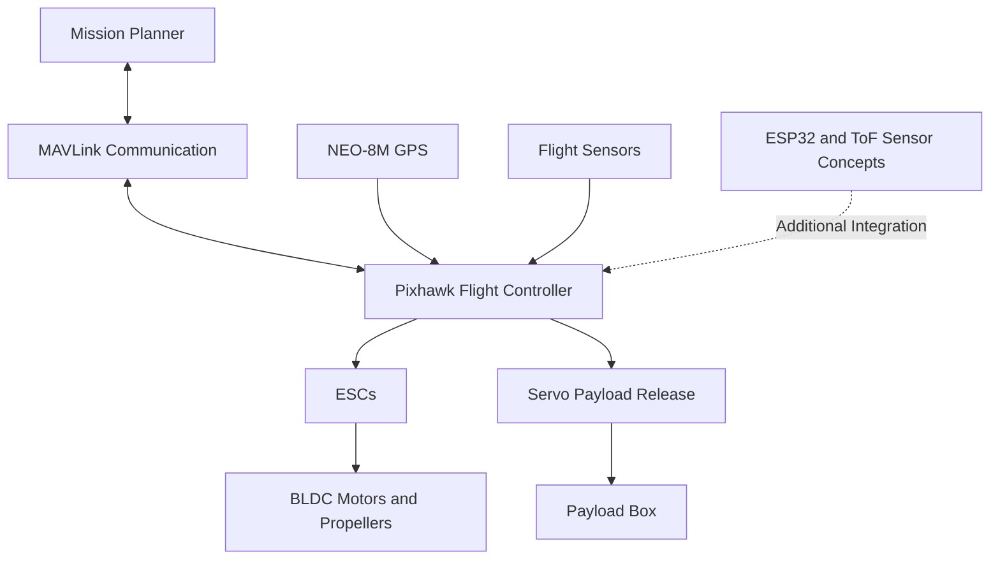
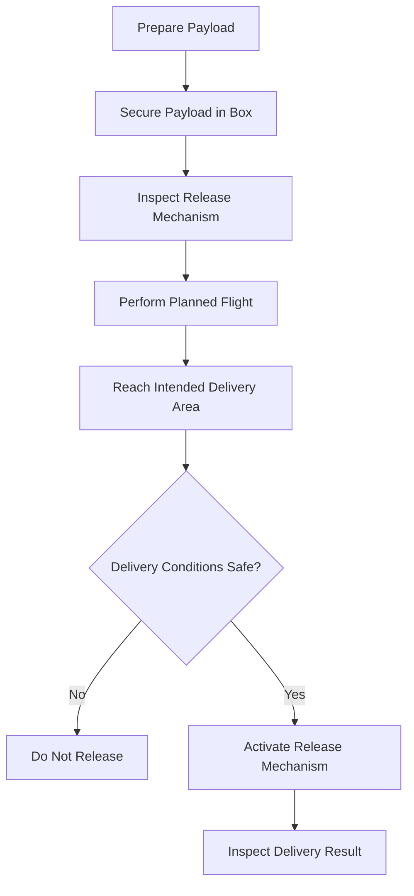

# 🚁 Aero Drop — Smart Drone System for Medical and Essentials Delivery

### An Embedded Systems Project for Drone-Based Medical Logistics

Aero Drop is a smart drone delivery project designed to explore the transportation of medical supplies and essential items using an unmanned aerial vehicle (UAV).

The project combines drone hardware, GPS-based waypoint navigation, flight control, mission planning, and a servo-based payload release mechanism. It explores how drone technology and embedded systems can support delivery applications, particularly in locations where conventional transportation may be difficult or time-consuming.

The system uses a Pixhawk 2.4.8 flight controller, a NEO-8M GPS module, Mission Planner, and a payload delivery mechanism. Additional concepts include ESP32-based interfacing, MAVLink communication, MAVROS integration, and Time-of-Flight (ToF) distance sensing.

**Project focus:** Drone-based logistics, embedded systems, GPS navigation, flight control, and payload delivery.

---

## 📌 Table of Contents

- [About the Project](#-about-the-project)
- [Problem Statement](#-problem-statement)
- [Objectives](#-objectives)
- [Proposed Solution](#-proposed-solution)
- [System Architecture](#-system-architecture)
- [Hardware Components](#-hardware-components)
- [Software and Technologies](#-software-and-technologies)
- [Working Principle](#-working-principle)
- [GPS Waypoint Navigation](#-gps-waypoint-navigation)
- [Payload Delivery Mechanism](#-payload-delivery-mechanism)
- [Communication and Integration](#-communication-and-integration)
- [Safety and Failsafe Considerations](#-safety-and-failsafe-considerations)
- [Project Implementation](#-project-implementation)
- [Testing and Results](#-testing-and-results)
- [Challenges and Limitations](#-challenges-and-limitations)
- [Applications](#-applications)
- [Future Enhancements](#-future-enhancements)
- [Learning Outcomes](#-learning-outcomes)
- [Project Structure](#-project-structure)
- [Author](#-author)
- [Connect With Me](#-connect-with-me)

---

## 🚀 About the Project

Medical supplies and essential items may need to reach people in areas with limited road connectivity, traffic congestion, or challenging terrain. Drone delivery is one potential approach to improving the transportation of lightweight supplies.

Aero Drop explores this concept through a drone platform equipped with a flight controller, GPS navigation, propulsion components, and a payload release mechanism.

The project combines hardware integration with mission planning and embedded-system concepts. A flight mission can be planned using supported ground-control software, while the payload mechanism is designed to release the carried item at the intended delivery stage.

The project also explores additional technologies for future system improvements, including obstacle-distance sensing and companion-computer integration.

### Project Information

| Property | Details |
|---|---|
| Project Name | Aero Drop |
| Project Category | Drone-Based Delivery System |
| Application Area | Medical Logistics and Essential Supplies |
| Domain | Embedded Systems, UAVs, Robotics |
| Flight Controller | Pixhawk 2.4.8 |
| GPS Module | NEO-8M |
| Ground-Control Software | Mission Planner |
| Communication Concepts | MAVLink and MAVROS |
| Payload Mechanism | Servo-controlled release |
| Additional Controller | ESP32 |
| Distance-Sensing Concept | Time-of-Flight (ToF) sensors |

## 🎯 Problem Statement

Delivering medical supplies and essential items to remote or difficult-to-access locations can present transportation challenges.

A drone-based delivery system could provide an alternative way to transport lightweight items along planned routes, subject to payload limits, flight time, weather, navigation accuracy, and applicable aviation regulations.

The project investigates the hardware and software concepts needed to develop such a system.

## 🎯 Objectives

- Explore drone-based delivery of medical supplies and essential items.
- Integrate a Pixhawk flight controller with GPS-based navigation.
- Plan and monitor flight missions using Mission Planner.
- Explore waypoint-based navigation.
- Develop a servo-based payload release mechanism.
- Understand communication using MAVLink.
- Explore MAVROS and ESP32 integration concepts.
- Investigate ToF sensors for distance measurement and obstacle detection.
- Study flight safety, failsafe behavior, and payload handling.
- Evaluate the prototype through practical testing.

## 💡 Proposed Solution

Aero Drop uses a multirotor drone platform to carry a lightweight payload along a planned flight route.

The flight controller manages the vehicle's flight-control functions. GPS provides positioning information, and Mission Planner supports mission planning and monitoring. A servo-operated mechanism is intended to release the payload at the designated delivery stage.

The overall workflow consists of:

1. Preparing and inspecting the drone.
2. Checking the battery, propulsion system, GPS, and flight controller.
3. Planning a suitable mission using ground-control software.
4. Performing the flight under appropriate safety conditions.
5. Reaching the intended delivery area.
6. Operating the payload release mechanism.
7. Recording the outcome and inspecting the system after landing.

The level of automation depends on the actual hardware integration and software configuration used in the prototype.

## 🏗️ System Architecture

The system can be understood as five functional blocks.

### 1. Flight Control

The Pixhawk 2.4.8 acts as the flight controller. It processes sensor information and manages flight-control functions according to its configured firmware and operating mode.

### 2. Positioning and Navigation

The NEO-8M GPS module provides positioning information for navigation and waypoint-based mission planning.

### 3. Propulsion System

Brushless DC motors, electronic speed controllers, propellers, and the drone frame provide the thrust and mechanical structure needed for flight.

### 4. Payload Delivery

A servo-based mechanism controls the payload release. The payload box is intended to carry medical supplies or other lightweight essential items.

### 5. Monitoring and Additional Integration

Mission Planner provides mission-planning and monitoring capabilities. MAVLink is a communication protocol used by compatible flight-control and ground-control systems. MAVROS and ESP32 are additional integration technologies explored in the project.

### System Block Diagram



*The diagram illustrates the system concept. Actual connections and integrations should be confirmed against the assembled prototype.*

## 🔩 Hardware Components

| Component | Purpose |
|---|---|
| Pixhawk 2.4.8 | Flight-control hardware |
| NEO-8M GPS Module | Positioning and navigation data |
| Pixhawk Power Module | Flight-controller power monitoring and power interfacing, according to its specifications |
| EMAX 930KV BLDC Motors | Propulsion |
| ReadyToSky 30A ESCs | Electronic motor-speed control |
| 5200mAh LiPo Battery | Electrical power source |
| Drone Frame | Mechanical support for the system |
| Propellers | Generate thrust |
| Servo Motor | Operates the payload release mechanism |
| Payload Box | Holds the item being transported |
| ESP32 | Additional embedded-control and interfacing platform |
| ToF Sensors | Distance-measurement and obstacle-detection concepts |

**Note:** The suitability of each component depends on the assembled vehicle's total mass, motor and propeller combination, electrical requirements, and intended payload.

## 💻 Software and Technologies

### Mission Planner

Mission Planner is ground-control software used with supported autopilot systems. It can be used to configure a vehicle, plan waypoints, monitor telemetry, and review mission information.

### Pixhawk and Flight-Control Firmware

The Pixhawk flight controller runs compatible autopilot firmware. Its configuration determines the available flight modes, navigation capabilities, and failsafe behavior.

### GPS Waypoint Navigation

GPS positioning supports navigation toward planned geographic waypoints. Actual position accuracy and navigation performance depend on GPS reception, environmental conditions, calibration, and system configuration.

### MAVLink

MAVLink is a lightweight messaging protocol used for communication between compatible flight controllers, ground-control stations, and other connected systems.

### MAVROS

MAVROS provides ROS integration with MAVLink-compatible autopilot systems. It is a potential interface for higher-level robotics applications where the required software and hardware are available.

### ESP32

The ESP32 is a microcontroller platform that can support additional control, sensor interfacing, and communication tasks. Its role depends on the implemented circuit and firmware.

### ToF Sensors

Time-of-Flight sensors estimate distance by measuring the travel time of emitted and reflected light. They can support proximity sensing, but safe obstacle avoidance requires suitable sensor placement, validated software, and reliable vehicle integration.

## ⚙️ Working Principle

The overall operating concept is divided into four stages.

### Stage 1: Pre-Flight Preparation

- Inspect the frame, propellers, motors, ESCs, and battery.
- Check the flight controller and GPS installation.
- Verify sensor connections and payload attachment.
- Confirm that the vehicle is configured correctly.
- Check the planned operating area and applicable safety requirements.

### Stage 2: Mission Planning

- Connect the supported ground-control system.
- Check the vehicle's reported status.
- Configure a suitable mission using Mission Planner.
- Define the intended waypoints and delivery area.
- Review the route, battery requirements, and configured failsafes.

### Stage 3: Flight and Payload Handling

- Operate the drone under suitable conditions.
- Monitor vehicle status and navigation information.
- Follow the approved mission and operating procedures.
- Operate the payload release mechanism only when appropriate for the test.

### Stage 4: Recovery and Evaluation

- Recover and secure the vehicle.
- Inspect the drone and payload mechanism.
- Review the delivery location and test observations.
- Record any deviations, failures, or improvements required.

## 🛰️ GPS Waypoint Navigation

Waypoint navigation allows a compatible autopilot to follow a sequence of geographic locations defined in a mission.

For Aero Drop, the navigation concept involves:

1. Establishing a suitable GPS position.
2. Preparing waypoints using ground-control software.
3. Uploading the mission to the supported flight controller.
4. Monitoring navigation and vehicle status.
5. Evaluating the final delivery location.

GPS waypoint navigation does not guarantee precise landing or payload placement. Wind, GPS error, vehicle dynamics, and payload movement can affect the result.

## 📦 Payload Delivery Mechanism

The payload delivery mechanism is designed around a servo motor and a payload box.

The servo moves a mechanical latch or release component so the payload can be released at the intended stage of the mission.

### Functional Requirements

- Secure the payload during flight.
- Avoid accidental release.
- Provide sufficient mechanical clearance.
- Ensure the servo and linkage are suitable for the load.
- Verify the release mechanism before flight.
- Confirm that the release area is safe and permitted.

### Delivery Workflow



The actual release trigger—manual, mission-based, or controlled by additional electronics—should be documented according to the mechanism implemented in the prototype.

## 📡 Communication and Integration

### Flight Controller and Ground Station

The flight controller and ground-control software communicate using a supported telemetry connection and compatible protocol configuration.

### ESP32 Integration

An ESP32 can support additional sensing or control tasks. Its exact role in Aero Drop depends on the implemented firmware and wiring.

### MAVROS Integration

MAVROS is a possible integration path for ROS-based control, monitoring, or sensor-processing applications. It should be described as implemented only if the corresponding software configuration has been tested.

### ToF Sensor Integration

ToF sensors can provide distance readings for a supported proximity-sensing system. Reliable obstacle avoidance requires more than distance measurement alone: the system must interpret sensor data and respond safely to detected obstacles.

## 🛡️ Safety and Failsafe Considerations

Drone testing must be performed with appropriate supervision, a controlled test area, and compliance with applicable aviation requirements.

Important considerations include:

- Battery condition and safe electrical connections.
- Propeller and motor inspection.
- Correct flight-controller configuration and calibration.
- GPS and telemetry status.
- Configured low-battery and communication-loss failsafes.
- Safe manual override and recovery procedures.
- Payload retention and controlled release.
- Separation from people, animals, roads, and obstacles.
- Weather and wind limitations.
- Verification of the actual vehicle's capabilities before autonomous operation.

A safety feature should only be listed as implemented after its behavior has been tested and documented.

## 🧪 Project Implementation

The project brings together drone hardware and software concepts to explore a delivery workflow.

The implementation areas include:

- Flight-controller and GPS integration.
- Mission planning with Mission Planner.
- Propulsion-system integration.
- Payload box and servo release mechanism.
- Investigation of communication and additional sensing options.
- Prototype testing and delivery-location evaluation.

The specific completion status of individual subsystems should be documented based on the final hardware and software used in the project.

## 📊 Testing and Results

The prototype was tested at the college and in Kondruprolu village, according to the project testing records.

A reported payload delivery result placed the delivered item approximately **2–3 metres from the intended target**.

This result provides a practical observation of the delivery prototype, rather than a guarantee of delivery accuracy in other conditions.

### Test Summary

| Parameter | Reported Result |
|---|---|
| Testing locations | College and Kondruprolu village |
| Test objective | Evaluate drone-based payload delivery |
| Reported delivery deviation | Approximately 2–3 metres from the target |
| Evaluation method | Observe the delivery location relative to the intended target |

### Further Testing Recommended

For a more complete technical evaluation, future tests should record:

- Number of test flights.
- Flight duration and battery consumption.
- Payload mass.
- GPS conditions and navigation status.
- Wind and weather conditions.
- Delivery distance from the target.
- Successful and unsuccessful payload releases.
- Repeatability across multiple tests.

These measurements can help evaluate reliability and identify improvements.

## ⚠️ Challenges and Limitations

Potential engineering challenges include:

- GPS position error and delivery-location variation.
- Payload mass affecting flight time and handling.
- Battery capacity and power consumption.
- Vibration and mechanical stability.
- Reliable servo operation.
- Telemetry and communication interruptions.
- Sensor limitations and environmental interference.
- Safe operation near obstacles.
- Differences between planned and actual flight paths.

The reported delivery deviation indicates that payload placement can be improved. Further calibration, controlled testing, and suitable delivery procedures may help evaluate possible improvements.

## 🌍 Applications

Potential applications for appropriately designed and authorized drone delivery systems include:

- Transportation of lightweight medical supplies.
- Delivery of first-aid materials.
- Transport of small essential items.
- Logistics support in remote locations.
- Emergency-response supply delivery.
- Research and education in autonomous aerial systems.

These are potential applications of the technology, not claims that the prototype is certified for medical or commercial delivery.

## 🔮 Future Enhancements

Possible improvements to Aero Drop include:

- Improving delivery-location accuracy.
- Evaluating GPS performance and navigation repeatability.
- Improving the mechanical payload release mechanism.
- Recording flight telemetry and test results.
- Integrating additional sensor feedback where appropriate.
- Investigating validated obstacle-detection and avoidance capabilities.
- Exploring ROS and MAVROS integration.
- Improving battery and payload performance.
- Developing a structured testing and safety checklist.
- Evaluating automated payload release with appropriate safeguards.
- Adding a dashboard for monitoring test information.
- Exploring geofencing and additional failsafe measures.

These enhancements are proposed future work unless already implemented and tested.

## 📚 Learning Outcomes

This project provides practical learning opportunities in:

- UAV hardware integration.
- Flight-controller configuration.
- GPS-based navigation.
- Mission planning and telemetry monitoring.
- Brushless motors and electronic speed controllers.
- Battery and power-system considerations.
- Servo-based mechanical control.
- Embedded-system integration.
- MAVLink communication concepts.
- ESP32 and sensor interfacing.
- Prototype testing and performance evaluation.
- Safety considerations for autonomous systems.

It also demonstrates how electronics, embedded software, mechanical components, and navigation technologies can work together in an engineering project.

## 📂 Project Structure

The following is a suggested repository structure. Update it to match the actual files you upload.

```text
Aero-Drop-Drone-Delivery/
├── README.md
├── docs/
│   ├── system-architecture.md
│   ├── hardware-components.md
│   └── testing-results.md
├── diagrams/
│   └── system-block-diagram.png
├── images/
│   ├── drone-prototype.jpg
│   ├── payload-mechanism.jpg
│   └── testing.jpg
└── code/
    └── [actual source files, if applicable]
```

### Recommended Repository Contents

- `README.md` — Main project documentation.
- `docs/` — Supporting technical documentation.
- `diagrams/` — System block diagrams and architecture illustrations.
- `images/` — Original project photos and testing images.
- `code/` — Actual source code, if developed and available for publication.

Do not create empty folders or include source files that do not exist. Upload original project photos and diagrams where possible.

## 👨‍💻 Author

**Ajay Uppalapati**

Electronics and Communication Engineering graduate interested in Embedded Systems, C Programming, Linux, IoT, and drone technology.

Aero Drop represents my interest in applying electronics and embedded-system concepts to real-world engineering challenges.

## 🔗 Connect With Me

- **GitHub:** https://github.com/uppalapati-Ajay
- **LinkedIn:** [www.linkedin.com/in/ajay-uppalapati-06865124b]

---

⭐ Thank you for exploring Aero Drop — Smart Drone System for Medical and Essentials Delivery.

*This repository documents an educational prototype and its engineering concepts. It is not a certification of flight safety, medical-delivery readiness, or regulatory approval.*
