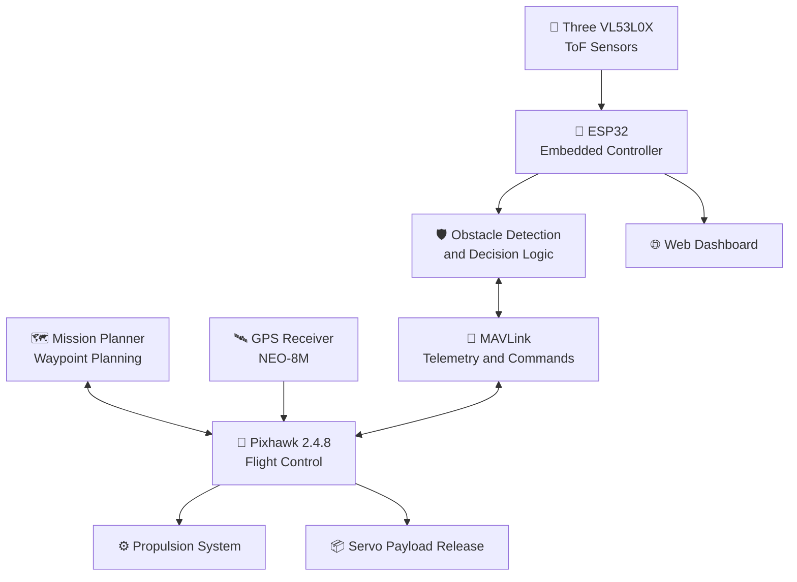
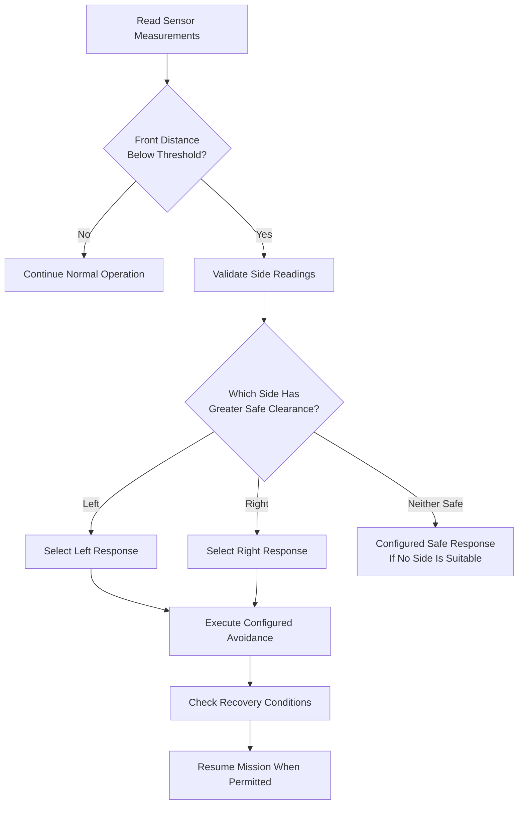

# 🚁 Aero Drop
### Smart Drone System for Medical & Essentials Delivery

<p align="center">
  <strong>Autonomous Navigation • Intelligent Obstacle Avoidance • Smart Payload Delivery</strong>
</p>

<p align="center">
  An embedded-systems drone prototype combining Pixhawk flight control, GPS waypoint navigation, ESP32-based obstacle avoidance, MAVLink communication, and servo-operated payload release.
</p>

<p align="center">
  
  
  
  
</p>

---

## 🌟 About the Project

**Aero Drop is an autonomous drone-delivery prototype designed to explore the transportation of lightweight medical supplies and essential items.**

The system integrates GPS-based navigation, autonomous mission planning, real-time distance sensing, embedded decision-making, flight telemetry, and controlled payload release.

Unlike a drone configured only to follow predefined waypoints, Aero Drop also explores a local obstacle-response mechanism using three VL53L0X Time-of-Flight (ToF) sensors connected to an ESP32-based embedded subsystem.

When an obstacle is detected in the forward direction, the programmed logic evaluates the available left and right clearances and initiates the configured avoidance response through the flight-controller communication interface.

The project also includes an ESP32-hosted web dashboard for observing flight status, sensor readings, and obstacle-detection information.

> **The core idea:** Combine autonomous flight, local obstacle sensing, embedded control, and payload delivery into one integrated drone prototype.

## ✨ Key Features

<table>
  <tr>
    <td width="50%">
      <h3>🗺️ Autonomous Navigation</h3>
      GPS-based waypoint missions planned and monitored using Mission Planner.
    </td>
    <td width="50%">
      <h3>🛡️ Obstacle Avoidance</h3>
      Three ToF sensors provide front, left, and right distance measurements for local avoidance decisions.
    </td>
  </tr>
  <tr>
    <td width="50%">
      <h3>📦 Payload Release</h3>
      Servo-operated mechanism for releasing a carried item at the configured delivery stage.
    </td>
    <td width="50%">
      <h3>📡 MAVLink Communication</h3>
      Exchange of supported telemetry and control messages between the embedded subsystem and autopilot.
    </td>
  </tr>
  <tr>
    <td width="50%">
      <h3>🌐 Live Monitoring</h3>
      ESP32-hosted web interface displaying selected flight and sensor information.
    </td>
    <td width="50%">
      <h3>⚙️ FreeRTOS Task Design</h3>
      Separation of sensor acquisition, communication, avoidance logic, web serving, and debugging activities.
    </td>
  </tr>
</table>

---

## 🧠 How the System Works



*This is a conceptual architecture diagram. Exact interfaces and command behavior depend on the implemented firmware and hardware configuration.*

### 🔄 Mission Workflow

1. **Plan** — Create the waypoint mission in Mission Planner.
2. **Inspect** — Verify GPS, sensors, telemetry, battery, and flight-controller status.
3. **Navigate** — Execute the configured autonomous mission under appropriate supervision.
4. **Sense** — Read front, left, and right distance measurements.
5. **Evaluate** — If the front obstacle threshold is crossed, compare the available side clearances.
6. **Respond** — Initiate the configured obstacle-avoidance procedure.
7. **Recover** — Release temporary control commands and resume only when the configured conditions permit.
8. **Deliver** — Activate the configured servo mechanism at the delivery stage.
9. **Review** — Verify the delivery outcome and inspect the flight logs.

---

## 🔩 Hardware Components

| Component | Specification | Role |
|---|---|---|
| Flight controller | Pixhawk 2.4.8 | Flight stabilization, navigation, and autopilot functions |
| GPS module | NEO-8M | Position information for waypoint navigation |
| Embedded controller | ESP32 | Sensor processing, avoidance logic, communication, and web server |
| Distance sensors | 3 × VL53L0X ToF | Front, left, and right obstacle-distance measurements |
| BLDC motors | EMAX 930KV | Drone propulsion |
| ESCs | ReadyToSky 30A | Motor-speed control |
| Battery | 5200 mAh LiPo | Electrical power source |
| Power module | Pixhawk power module | Flight-controller power interface and supported monitoring |
| Actuator | Servo motor | Payload-release mechanism |
| Payload enclosure | Prototype payload box | Carries the delivery item |
| Structure | Drone frame and propellers | Mechanical support and thrust generation |

<details>
<summary><strong>🔍 Explore the role of each component</strong></summary>

### Pixhawk 2.4.8

The main flight-control unit executes the configured autopilot functions and coordinates the aircraft's response to navigation and control inputs.

### NEO-8M GPS

Provides positioning information used by the flight controller during supported waypoint missions. GPS quality depends on satellite visibility, antenna placement, and operating conditions.

### ESP32

Runs the embedded logic for distance-sensor processing, obstacle-response decisions, MAVLink communication, and web-based monitoring.

### VL53L0X ToF sensors

Measure distance using an optical time-of-flight principle. The three sensors provide local information in the front, left, and right directions.

The commonly quoted maximum ranging distance is approximately 2 m under suitable conditions; practical performance must be verified on the assembled system.

### EMAX 930KV motors and ReadyToSky ESCs

The motors generate thrust, while the ESCs regulate the electrical power supplied to the motors in response to supported control signals.

### 5200 mAh LiPo battery

Supplies electrical energy to the system. Actual flight time depends on total mass, current consumption, battery condition, propulsion configuration, and flight conditions.

### Servo and payload box

The servo actuates the release mechanism. The payload box secures the carried item. Reliable delivery requires testing the mechanism, payload attachment, balance, and release behavior.

</details>

---

## 🗺️ Autonomous Navigation with Mission Planner

Mission Planner is used to prepare and monitor the aircraft's waypoint missions.

**Mission-planning process:**

- Connect to the configured flight-controller interface.
- Check GPS status, position estimate, battery, calibration, and arming checks.
- Create and review the waypoint sequence.
- Configure supported mission commands and altitude settings.
- Upload the mission and verify the configuration.
- Conduct a supervised test in an authorized area.
- Monitor telemetry and review the flight log.

### Telemetry and mission monitoring

Depending on the configured telemetry stream, useful parameters include:

- Position and GPS status.
- Altitude and velocity.
- Flight mode and arming status.
- Battery information.
- Mission progress.
- Relevant flight-controller messages.

The actual parameters available depend on the autopilot firmware, configuration, and telemetry connection.

---

## 🛡️ Real-Time Obstacle Avoidance

The obstacle-avoidance subsystem combines three distance sensors with embedded decision logic.

### Sensor arrangement

```text
                  FRONT
               [VL53L0X]
                   ↓
             ┌───────────┐
 LEFT        │   DRONE   │        RIGHT
[VL53L0X] →  │           │  ← [VL53L0X]
             └───────────┘
```

### Decision process



The diagram represents the intended decision concept. The actual firmware's state transitions and safe-response behavior must be verified.

### Important technical considerations

- The obstacle threshold must be configured and tested.
- Invalid or stale readings should not be treated as reliable clearance.
- Three directional sensors do not provide complete 360-degree coverage.
- MAVLink commands must be compatible with the installed autopilot and active flight mode.
- Temporary control overrides must be released correctly.
- Mission resumption must depend on explicit conditions, not simply elapsed time.
- If neither side is safe, the system needs a defined safe response.

**Current scope:** Local obstacle detection and response. The documented design does not establish full SLAM, comprehensive 3D mapping, or global route replanning.

---

## 📦 Payload Delivery Mechanism

The payload system uses a servo-operated release mechanism.

### Delivery sequence

1. Secure the payload in the box.
2. Verify the release mechanism before flight.
3. Prepare and review the mission.
4. Reach the configured delivery stage.
5. Issue the supported servo command.
6. Verify that the mechanism operates and the payload releases.
7. Record the actual delivery location and deviation from the intended target.

Mission commands such as `DO_SET_SERVO` may be used when supported by the installed autopilot and configured output. The exact servo channel, PWM values, and activation sequence must come from the tested configuration.

### Payload capacity and delivery accuracy

| Measurement | Current documentation status |
|---|---|
| Battery capacity | 5200 mAh |
| Maximum tested payload | Not yet verified |
| Flight endurance | Requires measured test data |
| Delivery deviation | Approximately 2–3 m previously reported; repeatable measurements not yet documented |
| Payload-release success rate | Requires recorded trials |

Battery capacity alone does not establish the maximum safe payload. A reliable capacity assessment requires measured mass, thrust margin, balance, current consumption, and controlled flight tests.

---

## 📡 MAVLink Communication

MAVLink connects the embedded subsystem to the flight-control communication interface.

The intended communication responsibilities include:

- Reading supported flight-mode and arming-state information.
- Receiving relevant telemetry.
- Sending supported commands for the configured avoidance procedure.
- Coordinating the release of temporary control commands.
- Supporting diagnostics and monitoring.

The firmware must specify the actual serial interface, baud rate, message handling, update rate, command timeouts, and error-recovery behavior.

Sending a command does not prove that the autopilot accepted it or that the aircraft executed the requested action. Where supported, command acknowledgements and vehicle-state feedback should be checked.

---

## 🌐 ESP32 Web Dashboard

The ESP32-hosted web server provides a browser-based monitoring interface.

| Display item | Purpose |
|---|---|
| Flight mode | Shows the reported flight-control mode |
| Arming status | Shows the reported armed/disarmed state |
| Front distance | Displays front sensor measurement |
| Left distance | Displays left sensor measurement |
| Right distance | Displays right sensor measurement |
| Obstacle state | Displays the programmed detection state |

The documented page-refresh interval is approximately **500 ms**. This does not guarantee that every sensor, telemetry, or control operation runs at the same frequency.

The dashboard is intended for monitoring and debugging, not as a replacement for a dedicated safety system.

---

## ⚙️ Embedded Software and FreeRTOS

The documented design separates the ESP32 activities into the following tasks.

| Task | Responsibility |
|---|---|
| MAVLink task | Receive and process flight-controller communication |
| Sensor task | Read and update distance measurements |
| Avoidance task | Evaluate obstacle conditions and coordinate responses |
| Web-server task | Serve the monitoring page and system information |
| Serial/debug task | Produce diagnostic output |

Task separation can improve code organization and responsiveness, but real-time performance depends on priorities, execution time, shared-data synchronization, stack allocation, and communication handling.

The repository should document the actual task priorities, stack sizes, timing assumptions, and error behavior from the implemented source code.

---

## 🧪 Testing and Validation

The project history describes autonomous mission flights, Loiter-mode hovering, obstacle-detection tests, and payload-delivery trials.

Previously reported observations include obstacle detection followed by an avoidance response and mission resumption under tested conditions. A payload-delivery deviation of approximately 2–3 m was also reported.

These are preliminary observations, not a complete quantitative validation dataset.

### Recommended validation checklist

- [ ] Verify all three ToF sensors against known distances.
- [ ] Test obstacle detection at the configured threshold.
- [ ] Verify left/right clearance comparison.
- [ ] Test invalid and stale sensor readings.
- [ ] Verify command handling in the intended flight mode.
- [ ] Test control-command release and recovery conditions.
- [ ] Verify dashboard readings against the underlying telemetry.
- [ ] Record payload mass and total takeoff mass.
- [ ] Record actual delivery position and target deviation.
- [ ] Measure flight endurance under a defined load.
- [ ] Review flight logs and document failures as well as successes.

---

## ⚠️ Limitations

- Three ToF sensors cannot detect every obstacle or provide complete spatial awareness.
- Sensor range and reliability vary with environmental conditions.
- GPS accuracy depends on reception and installation.
- The maximum safe payload has not been verified in the available project records.
- The reported delivery deviation requires repeatable measurements.
- Control behavior depends on the autopilot firmware and configured flight mode.
- A complete quantitative dataset for endurance, avoidance reliability, and payload performance is not yet documented.
- The project remains an academic prototype, not a certified commercial delivery system.

---

## 🚀 Future Enhancements

- Add broader obstacle coverage using suitable additional sensing hardware.
- Improve filtering and validation of sensor measurements.
- Add explicit safety-state management and communication timeouts.
- Log sensor data, decisions, and flight telemetry with timestamps.
- Quantify payload capacity, endurance, and delivery accuracy.
- Improve command verification and recovery handling.
- Document exact firmware, libraries, wiring, and build configuration.
- Explore more advanced obstacle mapping and route replanning.
- Build a reproducible firmware compilation and test workflow.

---

## 🛠️ Setup and Reproducibility

The exact setup instructions depend on the actual source code and hardware configuration.

Before treating the firmware as build-ready, document:

- ESP32 board and development environment.
- Required libraries and versions.
- Sensor wiring and interface configuration.
- MAVLink serial interface and baud rate.
- Autopilot firmware version and relevant parameters.
- Servo output configuration.
- Sensor thresholds and invalid-reading behavior.
- Firmware compilation, flashing, and verification steps.

Do not treat the firmware as reproducibly buildable until the real source files and tested build instructions are included.

---

## 📁 Suggested Repository Structure

```text
Aero-Drop-Drone-System/
├── README.md
├── LICENSE
├── .gitignore
├── PROJECT_STATUS.md
├── docs/
│   ├── system-architecture.md
│   ├── hardware-components.md
│   ├── autonomous-mission-planning.md
│   ├── obstacle-avoidance.md
│   ├── payload-delivery.md
│   ├── mavlink-communication.md
│   ├── freertos-task-design.md
│   ├── testing-and-results.md
│   └── safety-and-limitations.md
├── firmware/
│   ├── esp32/
│   └── README.md
├── hardware/
│   ├── components-list.md
│   └── wiring-and-interfaces.md
├── media/
│   ├── images/
│   └── mission-planner/
└── test-results/
    └── README.md
```

This is the proposed organization. Add only real source code, diagrams, photographs, and test data that are available.

---

## 👥 Project Team

**Institution:** Sir C. R. Reddy College of Engineering (Autonomous)  
**Department:** Electronics and Communication Engineering

**Project Guide:** Mr. A. M. Vamsi Krishna, M.Tech. (Ph.D.), Assistant Professor, Department of ECE.

**Team Members**

- U. S. V. Ajay — `23B85A0420`
- T. Pavani — `23B85A0419`
- Shaik Sadhiq — `22B81A04G5`
- S. Venkata Srikanth — `22B81A04G0`
- T. Sai Ganesh — `22B81A04H0`

---

## 🏁 Conclusion

Aero Drop integrates autonomous waypoint navigation, embedded distance sensing, local obstacle-response logic, MAVLink communication, servo-based payload release, and web-based monitoring into a drone-delivery prototype.

The project demonstrates the integration challenges involved in bringing flight control, sensing, communication, and actuation together. Future work will focus on quantitative testing, robust fault handling, reproducible firmware builds, and more comprehensive obstacle awareness.

<p align="center">
  <strong>🚁 Aero Drop — Exploring Smarter, Safer Autonomous Drone Delivery</strong>
</p>

---

<sub>Documentation reflects the project information currently available. Unverified specifications and performance claims are intentionally identified rather than invented.</sub>
